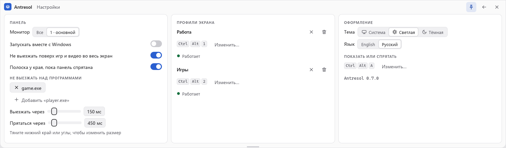

# Antresol — документация

Версия программы: 0.7.0

Это документация того, что есть сейчас. План и этапы — [SPEC.md](../SPEC.md), заметки для
следующей сессии — [HANDOFF.md](../HANDOFF.md).

## Что это и что уже работает

Панель быстрого доступа у верхнего края монитора (только Windows). Прячется за край, выезжает,
когда мышь упирается в край напротив панели, или по горячей клавише. Внутри пять модулей:

- **Экран** — разрешение, частота, масштаб выбранного монитора; избранное (до трёх разрешений) с
  запомненной частотой; профили всех мониторов с горячими клавишами;
- **Яркость** — яркость, контраст и вход внешних мониторов по DDC/CI;
- **Медиа** — что играет и кнопки «Назад», «Пауза», «Вперёд»;
- **Ресурсы** — процессор, видеокарта, память, сеть, батарея, место на дисках;
- **Кнопки** — свои кнопки из файла: программа, папка, файл или адрес.

Звука в панели нет: с 0.3.1 он убран, позже его даст программа Kamerton (см. SPEC.md).

Не сделано: значок программы, расположение мониторов в профиле, порядок и выключение модулей, остальные идеи
из [SPEC.md](../SPEC.md).

## Оглавление

- [Как пользоваться](guide/usage.md) — показ и скрытие, размер, модули, свои кнопки, настройки
- [Как устроено](architecture/overview.md) — части, файлы на диске, как добавить модуль
- [Как разрабатывать](dev/development.md) — сборка, проверки, живая проверка
- [Гайдлайн интерфейса](ui-guideline.md)
