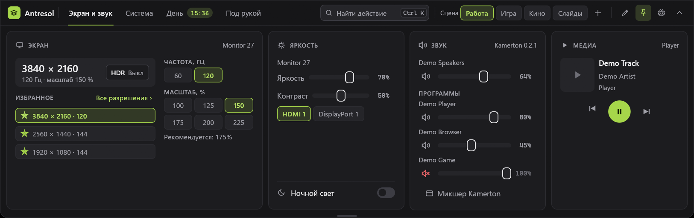
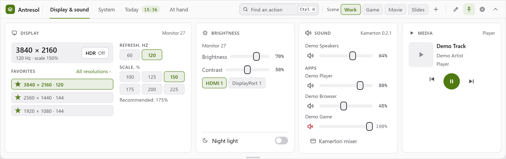
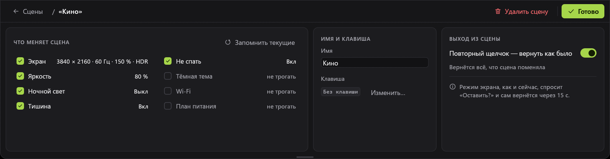
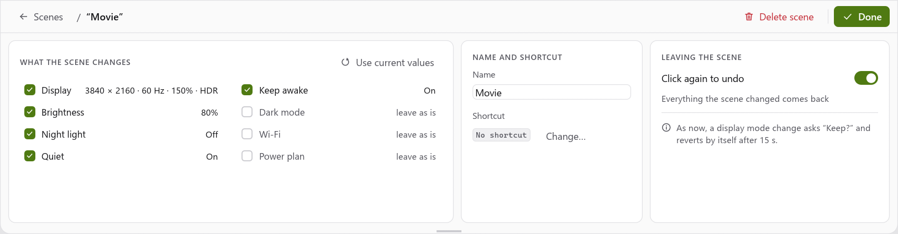
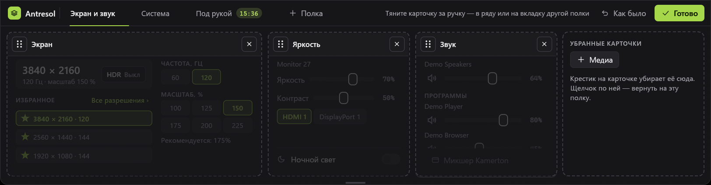
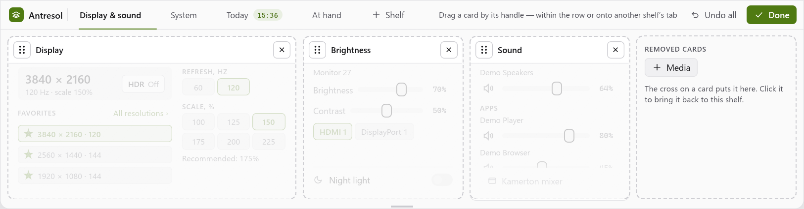
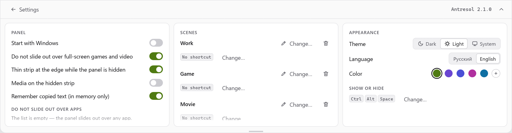
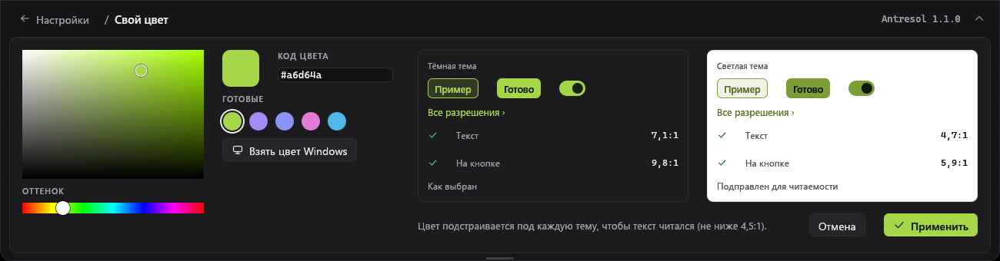
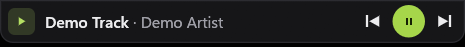

# Antresol — документация

Версия программы: 2.8.0

Это документация того, что есть сейчас. План и этапы — [SPEC.md](../SPEC.md), заметки для
следующей сессии — [HANDOFF.md](../HANDOFF.md).

Поиск действий — поле «Найти действие» в шапке, Ctrl+K, Ctrl+F или просто начать печатать: «ночн» — «Ночной свет», «1080» —
режим экрана, «чай 5» — таймер, «2*3,5» — 7; Enter выполняет. Каждое действие делает то же, что щелчок в карточке.

Сцены — «Работа», «Игра», «Кино»: экран и системные настройки (яркость, ночной свет, «Тишина», «Не спать», тёмная тема,
Wi‑Fi, план питания) одним щелчком по чипу в шапке или клавишей; повторный щелчок по стоящей сцене возвращает всё как было.
Правый щелчок по чипу — правка сцены. Отказались от режима («Вернуть» в «Оставить этот режим?», 15 секунд без ответа) —
вернулась вся сцена, не только экран.

Четыре полки — вкладки в шапке: «Экран и звук», «Система», «День», «Под рукой».

«Bluetooth» на полке «Система»: наушники, гарнитуры и колонки подключаются и отключаются щелчком по строке («Подключить» у не
подключённых; пока идёт — «Подключение…»); мышь и клавиатуру Windows подключает сама.

«Встречи» на полке «День»: ближайшая встреча из календаря Google или Outlook (по секретной ссылке .ics, учётная запись Windows не нужна),
служба, «через 12 мин» и «Подключиться»; ниже «Дальше сегодня». Без календаря в карточке — как подключить. За две минуты до встречи со
ссылкой у края появляется плашка с тем же «Подключиться».

«Буфер обмена» на полке «Под рукой»: текст, ссылки, цвета и картинки с фильтром («Все», «Текст», «Ссылки», «Картинки»,
«Цвета»); у текста, набранного не в той раскладке («Ghbdtn, rfr ltkf?»), — кнопка «Исправить раскладку».

Правка полок — карандаш в шапке: карточки тянут за ручку в ряду или на вкладку другой полки, крестик убирает
карточку в «Убранные».

Спрятанная панель: медиа на полоске.

Живые плашки у края — событие без выезда панели: наушники подключились (заряд), вставлена флешка («Открыть», «Извлечь»), упала
сборка (висит, пока не закроют), скачан файл («Открыть» или, у программы, «Показать в папке»; «В лоток»; файл можно потянуть с плашки),
заряд мыши 15 % и ниже, таймер дошёл («Готово»), через две минуты встреча («Подключиться»; висит до начала встречи). Обычная плашка висит 4 с (полоска внизу — сколько осталось; мышь над ней — время стоит), по одной,
остальные очередью; щелчок открывает панель на полке события. Выключатели — в настройках, «Живые плашки».

 
 
 

## Что это и что уже работает

Панель быстрого доступа у верхнего края монитора (только Windows). Прячется за край, выезжает,
когда мышь упирается в край напротив панели, или по горячей клавише. В шапке — вкладки полок, поиск действий и сцены; цвет программы — лайм или свой; пока панель спрятана, на полоске у края может быть плеер, а события — плашками. Внутри
пятнадцать карточек на четырёх полках (какие карточки, на какой полке и в каком порядке — правка полок прямо
на панели, карандаш в шапке):

- **Экран** — разрешение, частота, масштаб выбранного монитора; кнопка «HDR» (включает HDR только этого монитора, а не
  всех сразу, как Win+Alt+B); избранное (до трёх разрешений) с запомненной частотой, «Сделать основным» (экран сцены —
  режим, масштаб и HDR всех мониторов — ставит эта карточка, сами сцены с горячими клавишами — в шапке);
- **Быстрые настройки** — плитки: «Не спать», тёмная тема Windows, «Тишина», Wi‑Fi; план питания; VPN Windows;
- **Яркость** — яркость, контраст и вход внешних мониторов по DDC/CI; внизу — выключатель «Ночной свет»;
- **Медиа** — что играет и кнопки «Назад», «Пауза», «Вперёд»;
- **Звук** — через программу [Kamerton](https://github.com/AgitAngst/Kamerton): громкость и «без звука»
  устройства вывода и программ, окно микшера Kamerton;
- **Ресурсы** — процессор, видеокарта, память, сеть, температура, батарея, место на дисках;
- **Буфер обмена** — закреплённые тексты (бывшие «Заготовки») и последние скопированные: текст, ссылки, цвета и картинки,
  фильтр по виду, «Исправить раскладку»; щелчок — обратно в буфер;
- **Инструменты** — пипетка (цвет с экрана) и текст с экрана (выделить область — распознанный текст в буфер);
- **Лоток** — файлы, брошенные на панель (и «В лоток» с плашки готовой загрузки);
- **Bluetooth** — сопряжённые устройства, подключено ли, заряд; наушники, гарнитуры и колонки подключаются и отключаются щелчком по строке
  (мышь и клавиатуру Windows подключает сама); подключилось само или села батарея — плашка у края;
- **Встречи** — ближайшая встреча из календаря Google или Outlook по секретной ссылке .ics (до пяти календарей; события, повторы, пояса и летнее
  время из самого файла), «Дальше сегодня», «Подключиться» к Zoom, Meet, Teams, Телемосту и другим; за две минуты до встречи со ссылкой — плашка у края;
- **Таймеры** — быстрые таймеры и «помидор»; идущий таймер виден меткой на вкладке своей полки, дошедший — плашкой у края;
- **Часы** — время в других поясах;
- **GitHub** — последний прогон CI и открытые пулл-реквесты своих репозиториев (только чтение); прогон упал или прошёл — плашка у края;
- **Кнопки** — свои кнопки из файла: программа, папка, файл или адрес.

Своего звука у панели нет (убран в 0.3.1): звуком управляет Kamerton, панель говорит с ним по каналу.

Не сделано: значок программы, расположение мониторов в сцене, остальные идеи
из [SPEC.md](../SPEC.md).

## Оглавление

- [Как пользоваться](guide/usage.md) — показ и скрытие, размер, полки и их правка, модули, свои кнопки, настройки
- [Как устроено](architecture/overview.md) — части, файлы на диске, как добавить модуль
- [Как разрабатывать](dev/development.md) — сборка, проверки, живая проверка
- [Гайдлайн интерфейса](ui-guideline.md)
