# Как пользоваться

## Показать и спрятать

- При запуске панель показывается на 2 с и уезжает за край — так видно, что программа работает.
- **Мышь к верхнему краю** напротив панели и задержать (по умолчанию 150 мс) — панель выезжает.
  Над игрой или видео во весь экран не выезжает (выключается в настройках). Выдвинутая так панель **клавиатуру у вашей
  программы не забирает** (окно неактивно, как у полоски): набирайте в ней дальше, ничего не попадёт в панель. Нажали мышью
  внутри панели — окно становится активным и берёт клавиатуру, а само нажатие работает как обычный щелчок (кнопка, вкладка,
  поле ввода). Вызванная клавишей показа или клавишей сцены берёт клавиатуру сразу. События (таймер дошёл, наушники
  подключились, вставлена флешка, упала сборка, скачан файл, через 2 минуты начнётся встреча) панель не выдвигают и клавиатуру не берут — это плашки у края
  (см. «Живые плашки у края»); щелчок по плашке открывает панель, и клавиатура у неё сразу.
- **Горячая клавиша** — первое свободное из: Ctrl+Alt+Пробел, Ctrl+Alt+A, Ctrl+Shift+Пробел,
  Ctrl+Alt+\`, или своё из настроек. Какое работает — видно в настройках. Второе нажатие прячет
  панель всегда, даже закреплённую, и снимает закрепление.
- Прячется, когда мышь ушла с панели (по умолчанию через 450 мс), по Esc (когда у панели клавиатура; даже закреплённая), а
  вызванная клавишей — когда щёлкнули мимо (или через 5 с, если мышь так и не пришла и окну не дали фокус).
- Пока панель спрятана, у края посередине — **полоска** 120 × 5; мышь у края — полоска становится шире
  (160 × 6) и наполняется акцентом за время задержки выезда: заполнилась — панель выезжает. Полоска — окно поверх всех: щелчок по этим 5 точкам у края достаётся ей. Над игрой во весь экран и над программами из списка «Не выезжать над программами»
  полоски нет и панель от края не выезжает (горячая клавиша показывает её всегда).
- **Край, от которого выезжает панель** (настройки «Панель», чипы под «Выезжать через»; сохраняется в `config.txt`):
  - «Зона у края» — где вдоль верхнего края мышь выдвигает панель: 100 % (по умолчанию — ровно под панелью), 150 %, 200 % ширины
    панели по её центру или «Весь край» монитора; шире монитора зона не бывает. В `config.txt` — `edge_zone=` (50…400, 0 — весь край).
  - «Толщина зоны» — сколько строк пикселей от верхнего края считаются краем: 1 (по умолчанию — только верхняя строка), 2, 4, 8;
    пригодится, когда над монитором стоит другой и мышь проскакивает край. `edge_depth=` (1…16).
  - «Размер полоски» — 100 (по умолчанию, 120 × 5), 150, 200, 300 % (неактивно без полоски); при отсчёте полоска растёт в той же доле.
    **Наведение на полоску тоже выдвигает панель**, как край. Полоска с медиа и плашки не выдвигают — на них кнопки. `strip_scale=` (50…400).
  - Значения вне пределов в `config.txt` поправляются к ближайшему пределу, нечисло — к значению по умолчанию.
- **Стрелка вверх** в шапке — спрятать (как Esc). **Канцелярская кнопка** — закрепить: панель не прячется
  сама. Закрыть программу — «Закрыть Antresol» внизу карточки «Панель» в настройках.
- **Медиа на спрятанной полоске** (настройка): пока у Windows есть медиа-сеанс (играет или на паузе), полоска у края — 372 × 34: обложка,
  «название · исполнитель» и кнопки «Назад», «Играть»/«Пауза», «Вперёд». Кнопки работают сразу, панель
  не выезжает, а клавиатура остаётся у программы, в которой вы работаете; щелчок по названию — открыть панель. Ничего не играет или мышь у края (идёт отсчёт выезда) —
  обычная полоска.
- **Событие** — таймер дошёл, наушники подключились, вставлена флешка, упала сборка, скачан файл, скоро встреча — показывается плашкой у
  края 372 × 48, а не выездом панели (см. «Живые плашки у края»); у таймера в плашке — «Готово». Плашка видна и при выключенной
  полоске.
- Пока ждёт ответа «Оставить этот режим?», тянут край или открыт поиск, сама панель не прячется (Esc и клавиша — прячут).

## Живые плашки у края

Событие, ради которого панель обычно открывают, показывается узкой **плашкой** у верхнего края монитора: панель не выезжает и
клавиатуру у вашей программы не берёт (окно неактивно, как у полоски). Плашка — окно 372 × 48 по центру края: слева значок
цветом события (акцент — обычное, красный — беда, жёлтый — оговорка), название полужирным и пояснение под ним, справа до двух
кнопок. Выезжает сверху и уезжает вверх; «Показывать анимацию» в Windows выключено — появляется и пропадает сразу. Плашки не
зависят от настройки «Полоска у края, пока панель спрятана».

| Событие | Плашка | Кнопки | Тёмная тема, русский | Светлая тема, English |
|---|---|---|---|---|
| Аудиоустройство Bluetooth подключилось | «Наушники: подключено», «Bluetooth · заряд 80 %» (значок — наушники; о мыши и клавиатуре «подключено» не говорят: они засыпают и просыпаются сами; своё подключение из карточки или поиска плашки не даёт — строка и так показывает) | — |  | 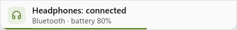 |
| Флешка вставлена | «Флешка «DEMO»», «32 ГБ · вставлена» (у флешки с несколькими разделами — одна плашка, размеры складываются) | «Открыть» со значком «наружу» (диск в проводнике), «Извлечь» (карте SD и MMC во встроенном картридере «Извлечь» не предлагается) | 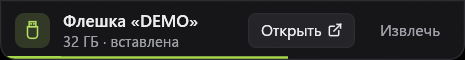 | 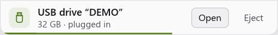 |
| Сборка упала | «demo/site: сборка упала», «main · 1 мин назад» (красная; висит) | «Открыть» со значком «наружу» — сам прогон в браузере; крестик справа | 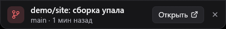 | 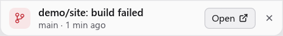 |
| Файл скачан | «отчёт.pdf: скачано», «1,2 МБ · Загрузки» | «Открыть» со значком «наружу», «В лоток»; файл можно потянуть с плашки | 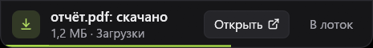 | 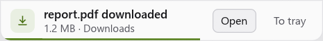 |
| Скачан файл, что при открытии запускается (программа, скрипт, установщик, ярлык, образ диска) | «annual_r…pdf.exe: скачано», «46 МБ · Загрузки» (длинное имя режется посередине, расширение остаётся на виду) | «Показать в папке» со значком «наружу» вместо «Открыть» и «В лоток» (названию нужно место); файл можно потянуть | 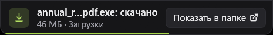 | 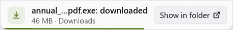 |
| Скачано несколько файлов сразу | «Скачано файлов: 3», «5,3 МБ · Загрузки» | «Показать в папке» (папка «Загрузки») | 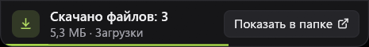 | 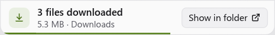 |
| Таймер дошёл | «Таймер дошёл» или «Таймер «чай» дошёл» (висит) | «Готово» |  |  |
| До встречи со ссылкой 2 минуты | «Планёрка через 2 мин», «10:30 · Zoom» (значок — календарь; минуты считаются при показе; висит до начала встречи — см. «Встречи») | «Подключиться» (главная) со значком «наружу» — ссылка встречи; крестик справа | 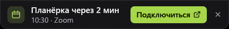 |  |

Остальные события: заряд любого устройства Bluetooth упал до 15 % и ниже («Мышь: разряжается», «Заряд 12 %», жёлтая; раз за
разряд — снова только после того, как заряд поднимется выше 20 % и упадёт); итог «Извлечь» («Можно вынимать»; «Не извлечь: диск
занят»; «Флешку уже вынули», жёлтые); сборка прошла («demo/site: сборка прошла», 4 с).

- **Время.** Обычная плашка висит 4 с; полоска `accent` внизу показывает, сколько осталось; пока мышь над плашкой или идёт
  «Извлекаю…», время стоит. Важная (упала сборка, таймер дошёл) висит, пока её не закроют: «Готово» или крестик справа.
  Плашка встречи висит так же, но у неё есть срок: когда встреча началась, она уходит сама (и показанная, и ждущая очереди).
- **Щелчок не сразу.** Плашка появляется сама, и щелчок, что целился в окно под ней (вкладки браузера у верхнего края),
  не должен ничего запустить: кнопки, крестик и тело плашки принимают щелчок через 0,4 с после того, как она встала на
  место (до этого кнопка под мышью не светится и «руки» нет). Подсказок в окне плашки нет; длинное имя файла, устройства или
  репозитория режется посередине, а не с конца, — расширение остаётся на виду.
- **Очередь.** По одной; остальные ждут своей очереди — до пяти (больше не копится: уходит самая старая обычная, важные
  берегутся). Повтор того же события заменяет плашку на месте.
- **Щелчок по плашке** выдвигает панель на полке карточки события («Bluetooth», «GitHub», «Лоток», «Таймеры», «Встречи»), если она на
  полке; у флешки карточки нет — панель просто открывается. Кнопки делают своё и панель не выдвигают.
- **«Извлечь»** — «Безопасное извлечение устройства» Windows: плашка остаётся, вместо пояснения «Извлекаю…», кнопки на ней не
  нажимаются, а время стоит, пока не придёт итог — он заменяет плашку на месте. «Можно вынимать» — только когда Windows
  ответила без отказа. Занят — «Не извлечь: диск занят», с той же кнопкой «Извлечь»: закройте программы, что держат файлы на
  диске, и нажмите снова. Перед извлечением проверяется, что на этой букве всё ещё та же флешка (по серийному номеру тома):
  вынули её, а букву занял другой диск, — «Флешку уже вынули», и ничего не извлекается. Флешка пропала — её плашка уходит
  (когда тома нет в двух чтениях подряд: после сна Windows отвечает неполным списком).
- **Скачанные программы не запускаются щелчком.** Файл, что при открытии запускается или ставится — программа, скрипт,
  установщик, ярлык, образ диска (`.exe`, `.msi`, `.bat`, `.cmd`, `.vbs`, `.ps1`, `.lnk`, `.iso`… — по списку Windows
  и ещё коротким списком), — «Открыть» на плашке не получает: вместо него «Показать в папке» (проводник с выделенным
  файлом). «В лоток» у такого файла нет (на название осталось бы около 100 точек), перетаскивание остаётся.
- **Много файлов сразу.** Распаковали архив или сохранили пачку: готовые за одно чтение «Загрузок» — одна плашка «Скачано
  файлов: 7» с общим размером и «Показать в папке» (откроет «Загрузки»), а не десять плашек подряд.
- **Файл с плашки загрузки** тянут мышью в чат, окно или папку (обычное перетаскивание Windows: копия или ссылка, файл не
  переносится и не удаляется); «В лоток» кладёт его в «Лоток». Тянуть начинают, сдвинув мышь с нажатой кнопкой, — долгое
  нажатие на месте не в счёт; файл, отпущенный над самой плашкой, в «Лоток» не падает.
- **Панель выдвинута** — события приходят уведомлениями («название · пояснение») и плашки нет; плашки, что ждали очереди, при
  выезде панели тоже уходят уведомлениями (та, что уже постояла на виду секунду, — молча: вы её видели), важные остаются и
  показываются, когда панель спрячется. Если панель вызвана клавишей (у неё клавиатура), уходят уведомлениями и важные:
  плашку из другого окна с клавиатуры не закрыть.
- **Игра во весь экран и «Не выезжать над программами».** Плашки не показываются, а копятся (до пяти) и встают, когда можно; уже
  показанная прячется и ждёт, время её не идёт. Настройка «Не выезжать поверх игр и видео во весь экран» выключена — плашки
  показываются и над игрой.
- **Показ экрана и «не беспокоить».** Пока Windows считает, что уведомления сейчас нежелательны (идёт показ экрана, игра во
  весь экран, режим «не беспокоить», вас нет за компьютером), плашки ждут, как над игрой; плашка таймера показывается — он ваш, а не чужое событие.
- **Мониторы.** При «Все мониторы» показанная плашка остаётся на своём мониторе, а не прыгает за мышью. Мышь, брошенная вверх
  через плашку к самому краю, панель не выдвигает.
- **Что считается новым.** Первое чтение после запуска (и после того, как плашки включили) ничего не объявляет: что уже
  вставлено, подключено и лежит в «Загрузках», — не новое. Флешки читаются раз в 2 с, папка «Загрузки» — раз в 3 с: файл
  готов, когда он не временный (`.crdownload`, `.part`, `.opdownload`, `.partial`, `.tmp`, `.download`, `.!ut`, `.!qB`),
  не пустой, рядом нет его временного двойника (Firefox держит пустой файл, пока пишет `имя.part`), другая программа его не
  пишет (проба открытия) и он не менялся 2 с — плашка появится, когда загрузка кончится; устройства Bluetooth — раз в 5 с
  (отключённым устройство считается, когда оно не подключено в двух чтениях подряд), прогоны GitHub — раз в 5 минут (один
  запрос на репозиторий); всё — в своих потоках, окно не ждёт, и только пока плашки этого вида включены. Календари «Встреч» читаются
  раз в 10 минут, пока программа работает, а плашка встречи — не «новое», а «скоро»: она приходит и по первому чтению, если до
  встречи меньше двух минут.
- **Выключатели** — «Настройки» → «Панель» → «Живые плашки»: чипы «Bluetooth», «Флешки», «GitHub», «Загрузки», «Встречи» (чип с
  акцентом — включён; ряд переносится на новую строку, когда тесно); в `config.txt` — `plaques_off=` с перечнем выключенного
  (`bluetooth,usb,github,downloads,meetings`; нет строки или она пустая — включено всё, и новый вид событий в следующих версиях тоже
  включён — так «Встречи» включены и у тех, кто плашки уже настраивал). Таймер выключить нельзя.
- **Чего нет.** Внешние жёсткие диски USB Windows считает постоянными, а не съёмными, — плашки о них нет (только флешки и
  карты). Пустой картридер молчит, пока в него не вставят карту; буква, что на деле папка (`SUBST`), флешкой не считается.
  Звука у плашки нет. Папка «Загрузки» на сетевом диске читается целиком раз в 3 с — это тысячи записей по сети; держите её
  на локальном диске.

## Размер

Тянуть нижний край (высота), боковые края (ширина, панель остаётся посередине) или нижние углы.
Ширина от 560 точек до ширины монитора (по умолчанию 1300), высота 150–520.

**Высота по полке** (с 2.8). У каждой полки своя высота: панель сама становится такой, чтобы самой высокой карточке
открытой полки хватило места без прокрутки, — от 150 до 440 точек (длиннее — список в карточке листается). Сменили
полку — панель плавно меняет высоту (за 0,2 с; при выключенных анимациях Windows — сразу). Потянули нижний край — это
своя высота **этой** полки (до 520), другие полки остаются «по полке»; **двойной щелчок по нижнему краю** — снова по
полке. Под мышью у нижнего края, рядом с чёрточкой, написано, какая высота сейчас: «Высота по полке» или «Своя высота ·
двойной щелчок — по полке». Настройки, поиск, «Свой цвет…», правка сцены и правка полок высоту не меняют — держится та,
что была; нижний край там задаёт высоту этих видов (`height=`). Пока мышь у низа панели, панель ниже не становится (нажали
«Очистить» в буфере — панель не уедет из-под мыши); ушла мышь вверх — становится.

Карточки открытой
полки не влезают (у «Экрана» наименьшая ширина 420, а если у какого-то монитора есть HDR — 480, при выборе монитора
шире: 548 при двух и трёх, 560 при четырёх, дальше больше; у «Встреч» 260 (и полторы доли ширины), у «Звука», «Ресурсов», «GitHub» и
«Быстрых настроек» 240, у остальных 220, между ними 10; пять карточек по 220–240 и «Экран и звук» с «Экраном» до 560 влезают в 1300 точек) — ряд
листается вбок:
полоса снизу, колесо мыши, колесо с Shift или кнопка «Ещё N ›» справа (N — сколько карточек не видно целиком;
листает к первой из них), край ряда затухает; у каждой полки своя прокрутка. Колесо над карточкой со списком сначала
листает список, а когда он дошёл до края (или листать нечего) — ряд; над ползунком громкости и яркости колесо меняет
только значение; так же листаются вбок настройки и правка сцены на
узкой панели. Размер запоминается.

## Шапка и полки

Слева — знак, «Antresol» и **вкладки полок**. Карточки разложены по четырём полкам, на экране — карточки открытой:

| Полка | Карточки |
|---|---|
| «Экран и звук» | Экран, Яркость, Звук, Медиа |
| «Система» | Быстрые настройки, Ресурсы, Bluetooth, GitHub |
| «День» | Встречи, Таймеры, Часы |
| «Под рукой» | Буфер обмена, Лоток, Инструменты, Кнопки |

У тех, кто полки уже настроил (версии 1.9–2.4), «День» появляется после обновления сам — в конце, с одной новой карточкой «Встречи»;
остальные карточки остаются на своих местах («Таймеры» и «Часы» — там, где стояли). Полок уже девять — «Встречи» встают в конец
последней; убрали «Встречи» (крестик в правке) — не возвращаются.

Открытая вкладка — полужирная, с чертой акцента на нижней линии шапки. Полку открывают щелчком по вкладке, колесом
мыши над вкладками (вверх — предыдущая, вниз — следующая; плавное колесо и тачпад — когда накрутили на щелчок), **Ctrl+Tab** и **Ctrl+Shift+Tab** (по кругу) и
**Ctrl+1…9** (полка с этим номером; не когда вводят текст). Открытая полка помнится, пока работает программа:
спряталась на «Под рукой» — выедет на ней же; в файл она не пишется. Идёт таймер — на вкладке его полки метка с
оставшимся временем («03:42», подсказка «Идёт таймер «5 мин», осталось 03:42»), пока открыта другая полка. Имена
готовых полок следуют за языком («Display & sound», «System», «Today», «At hand»); свои — как введены.

Справа налево: **стрелка вверх** — спрятать, **шестерёнка** — настройки, **булавка** — закрепить, **карандаш** —
«Изменить полки» (см. ниже), монитор панели («Все» и номера; виден, когда мониторов несколько) и **сцены** чипами
с подписью «Сцена» (их нет, пока убрана карточка «Экран»); левее них — **поле «Найти действие»** (см. «Поиск
действий»). Щелчок по чипу ставит сцену, а по стоящей сейчас (она выделена) — возвращает всё как было; **правый щелчок** —
правка сцены. В подсказке чипа — клавиша и что делают щелчки:
«Ctrl+Alt+3 · щелчок — включить, ещё щелчок — вернуть; правый щелчок — изменить» (без клавиши — без начала, у сцены без
возврата — без «ещё щелчок — вернуть»). **«+»** — новая сцена из того, что стоит сейчас: сразу открывается её правка
(см. «Сцены»). Не хватает места — по одному порядку на все ширины: прячутся подписи «Сцена» и «Монитор», потом слово «Antresol», потом
поле поиска сжимается до значка лупы (он есть всегда; целое поле — 204 точки), потом подписи вкладок сужаются многоточием
(полное имя — в подсказке; уже 72 точек подпись не бывает, пока справа сцены, и уже 36 — вообще), потом уходят выбор
монитора и сцены (сцены остаются в настройках и на клавишах). Что ушло при сужении панели, обратно не возвращается — слова и подписи не
мигают. В правке полок порядок свой: подсказка, подпись у «Как было», слово «Antresol», подпись у «Полка», потом вкладки.
Шапка обрезается по своему месту
и значки не закрывает: при девяти полках на самой узкой панели (560) последние вкладки не видны — их открывают
Ctrl+Tab и Ctrl+1…9.

## Правка полок

Карандаш в шапке («Изменить полки») включает правку прямо на панели; в шапке остаются «Полка», подсказка,
«Как было» и «Готово» (сцен, монитора, карандаша, булавки, шестерёнки и стрелки в правке нет, в настройки из неё
не попасть).

- **Карточки.** На каждой — полоса с **ручкой** (шесть точек), именем и **крестиком**; содержимое видно под
  вуалью, но не отвечает ни на мышь и колесо, ни на клавиатуру (фокус в него не заходит, Enter и пробел ничего не
  нажимают). Карточки в правке сжимаются до 150 точек (содержимое всё равно недоступно), а блок «Убранные карточки» — до
  220: так три готовые полки вместе с «Убранными» помещаются на панели в 1300 точек. Не помещается (узкая панель) —
  ряд листается, как и вне правки: «Ещё N ›» и колесо мыши (с Shift и без) работают и над карточками. Ручку тянут: по ряду —
  карточка встаёт туда, куда показывает черта акцента (вправо — после той, на которую навели, влево — перед ней); на
  **вкладку** другой полки — в конец той полки (вкладка при этом обведена пунктиром, а сама полка не переключается); на
  блок «Убранные карточки» — убрать. С клавиатуры (ручка в фокусе, Tab): **Alt+←/→** — сдвиг в ряду, **Alt+1…9** — на
  полку с этим номером, **Delete** — убрать.
- **Убранные карточки.** Крестик на карточке убирает её в блок «Убранные карточки» в конце ряда (только в правке);
  чип с её именем возвращает её в конец открытой полки. Убранная карточка не видна и систему не опрашивает, но
  работает в фоне: таймеры идут, буфер обмена запоминает, таймер дошёл — панель выезжает.
- **Полки.** «Полка» — новая полка «Полка N» в конце (до девяти; на девяти кнопка серая, подсказка «Полок не больше
  девяти — уберите ненужную»), она сразу открыта. **Двойной щелчок** по вкладке (или F2) переименовывает её — только в
  правке (вне правки это обычный щелчок: открывает полку): поле, Enter или щелчок мимо — сохранить, Esc — отмена,
  пустое имя не сохраняется (имя до 24 знаков). **Крестик** на вкладке под мышью (или Delete) убирает полку — её
  карточки уходят в «Убранные карточки»; последнюю полку убрать нельзя. Пустая полка — «На этой полке пусто» и кнопка
  «Изменить полки».
- **Выход.** «Как было» возвращает раскладку, какой она была на входе в правку (правка продолжается); «Готово» и
  Esc выходят (следующий Esc прячет панель). Каждое изменение сохраняется в `config.txt` сразу; панель спряталась —
  правка кончилась.
- **Клавиша сцены** в правке (а также в настройках) сначала выводит оттуда, а если «Оставить этот режим?» ждёт ответа
  на карточке другой полки, открывает эту полку: вопрос не остаётся под вуалью. То же — после щелчка по чипу сцены,
  пока открыта другая полка.

## Поиск действий

Любое действие панели можно найти и выполнить с клавиатуры: открыл панель, начал печатать, Enter — не нужно помнить, на
какой полке что лежит. Действие делает то же, что щелчок на своём месте в карточке: тем же модулем, с теми же
уведомлениями и вопросом «Оставить этот режим?».

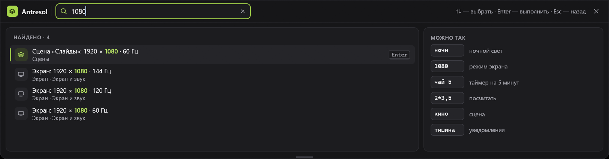

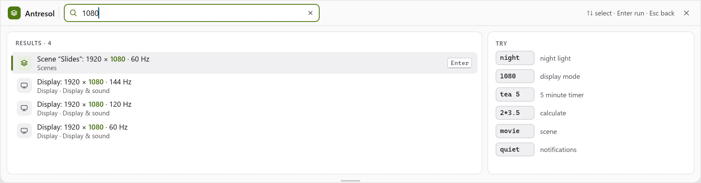

**Открыть.** Щелчок по полю «Найти действие» в шапке (оно левее сцен, справа в нём клавиша «Ctrl K», подсказка — «Или
просто начните печатать, пока панель открыта»), **Ctrl+K**, **Ctrl+F** или просто начать печатать: буква или цифра, пока
панель открыта и у неё клавиатура, фокус не в поле ввода и не идёт захват сочетания, открывает поиск с этой буквой
(пробел и знаки — нет).
Поиск открывается поверх карточек: в правке полок, правке сцены, настройках и «Своём цвете» он не открывается. Пока в
карточке вводят текст (фокус в поле «owner/repo» у «GitHub» или в поиске пояса у «Часов»), и буквы, и Ctrl+K с Ctrl+F идут
туда, а не в поиск. Пока висит «Оставить этот режим?», поиск открывают Ctrl+K и щелчок по полю, а печать — нет: вопрос не
должен уйти под поиск. Печать открывает поиск, только пока у панели есть клавиатура: её вызвали клавишей показа или клавишей
сцены либо в ней нажали мышью. Выдвинутая мышью у края панель клавиатуру не забирает, так что набранное в вашей
программе в поиск не попадает и случайный Enter ничего не выполнит. На узкой панели вместо поля — значок лупы с той же
подсказкой.

**Панель и поиск.** Пока открыт вид поиска, панель сама не прячется (ни уход мыши, ни потеря фокуса) — только Esc, крестик
«Закрыть поиск», клавиша показа панели или выполненное действие. Esc и крестик возвращают к карточкам, и панель снова
прячется по общим правилам. Поэтому «Пипетка» из поиска работает и у панели, выдвинутой мышью от края: мышь можно увести на нужный
цвет и нажать Enter.

**Вид.** Вместо карточек, как настройки и правка сцены. Шапка: знак, «Antresol», поле запроса (рамка акцента, лупа,
«Стереть» — когда есть что стирать), подсказка «↑↓ — выбрать · Enter — выполнить · Esc — назад» и крестик «Закрыть поиск
(Esc)»; вкладок, сцен и кнопок нет (тесно — первым уходит слово «Antresol», потом подсказка). Слева — карточка «Найдено ·
N» (N — сколько нашлось всего) со строками, до семи: значок, название с выделенным совпадением, под ним — где это
(«Яркость · Экран и звук» — карточка и полка); выбранная строка — на подложке, с полоской акцента и клавишей «Enter». Не
помещаются по высоте — список листается за выбранной строкой. Справа — «Можно так»: примеры запросов («ночн» — ночной
свет, «1080» — режим экрана, «чай 5» — таймер на 5 минут, «2*3,5» — посчитать, «кино» — сцена, «тишина» — уведомления);
щелчок подставляет запрос. Тело уже 640 точек (панель уже 664) — примеров нет. Ничего не нашлось — «Ничего не нашлось — попробуйте другое слово».

**Как ищет.** Без учёта регистра, «ё» и «е» — одна буква. Запрос — слова через пробел; каждое должно найтись в названии
действия или в его словах для поиска. Слова — на обоих языках («night» находит «Ночной свет» и при русском интерфейсе) и
с именем карточки: «яркость» находит и «Ночной свет», он лежит в карточке «Яркость»; имя полки в слова не входит — по
нему находится только «Открыть полку…».
Порядок: слово с начала названия, потом с начала слова, потом внутри слова, потом только в словах; при равенстве —
недавние выше, дальше — как действия идут на панели: сцены, карточки по полкам, своё у панели.

**Клавиши.** **↑** и **↓** — выбрать (по кругу не ходят), **Enter** — выполнить выбранную и вернуться к карточкам,
щелчок по строке — то же, **Esc** — назад к карточкам (следующий Esc прячет панель, как всегда). Стёрли запрос или
щёлкнули по примеру — поле снова в фокусе. Серая строка — недоступное действие: во второй строке причина (целиком — в
подсказке), Enter и щелчок её не выполняют, поиск остаётся. Название, что не влезло и обрезано многоточием, тоже целиком —
в подсказке к строке. Tab ведёт по полю, «Стереть», строкам и примерам, у строки в фокусе — рамка; у поля в шапке и у
«Стереть» есть имена для экранного диктора.

**Недавние.** Пустой запрос — до семи действий, что выполняли последними (помнятся, пока работает программа). Таких нет —
«Начните печатать». Помнятся сами вещи — файл лотка (по пути), закреплённый текст, своя кнопка, полка, сцена, — а не их
номера в списках: бросили в лоток новый файл, закрепили текст, переставили полки — «Недавние» не сползают на соседей.
Пропавшее (файл убрали из лотка, текст открепили, кнопку убрали из файла) не показывается; открытую полку не предлагают.

**Калькулятор.** Запрос из цифр, `+ − * /`, скобок, пробелов и `,` или `.` и хотя бы одним действием между числами —
первая строка «2*3,5 = 7» («Посчитать · Enter — скопировать результат»); Enter кладёт результат в буфер обмена («В буфере —
вставляйте»). Запятая в числе — по языку интерфейса: по-русски десятичная («2,5»), по-английски разделитель тысяч («1,000*2 = 2000»;
запятая не на месте, как в «1,5», — не число); точка десятичная всегда. Ответ — до 12 значащих цифр, без хвоста нулей и
без шума двоичной точности («0.1+0.2» — «0,3», «0.1+0.2-0.3» — «0»; «100/3» — «33,3333333333»); меньше 10⁻⁶ — с порядком
(«1/3000000 = 3,33333333333e-7»), а не нулём. Разбор свой, без `eval`. Деление на ноль, скобки не парой, два числа подряд,
результат от 10¹⁵ — строки нет.

**Таймер.** «<слово> <число>» или «<число> мин» (число 1–999; после числа можно «мин», «min», «м», «m»). «чай 5» — строка
«Таймер «чай» на 5 мин»; Enter запускает таймер со своим именем: оно — в списке карточки «Таймеры», в подсказке к метке на
вкладке («Идёт таймер «чай», осталось 04:58») и в уведомлении «Таймер «чай» дошёл» (на самой метке — только время). «5 мин» —
«Таймер на 5 мин», без имени, как у быстрых таймеров. Нашлось и действие («яркость 50» — «Яркость: 50 %») — таймер встаёт
следом за лучшим совпадением, а не первым. Карточки «Таймеры» нет ни на одной полке — строки таймера тоже нет.

**Что можно найти.** Карточки, которых нет ни на одной полке (убранные), действий не дают.

- **Сцены** — «Сцена «Кино»: 3840 × 2160 · 60 Гц» (режим — если у сцены один монитор; место — «Сцены · Ctrl+Alt+3», клавиша
  — если есть); Enter — как щелчок по чипу. Стоящая сцена — «Сцена «Кино»: вернуть как было» (если возврат включён).
  Находятся и по режиму, и по тому, что сцена меняет («тишина»). Висит «Оставить этот режим?» — серые: «Сначала ответьте на
  «Оставить этот режим?»».
- **Экран** — «Экран: 1920 × 1080 · 144 Гц»: все режимы монитора карточки, кроме стоящего (сначала избранные, с запомненной
  частотой); «Масштаб: 125 %» — кроме стоящего; «HDR: включить» / «HDR: выключить» (монитор HDR не умеет — нет; Windows не
  даёт включить — серое, «Windows сейчас не даёт включить HDR на этом мониторе»); «Сделать основным» (мониторов несколько и
  этот не основной). Режим ставится с «Оставить этот режим?», пока вопрос висит, действия «Экрана» серые.
- **Яркость** — «Яркость: 25 %», «50 %», «75 %», «100 %» всем мониторам, что отвечают по DDC/CI (пока опрашиваются —
  серые, «Опрашиваю мониторы…»; никто не отвечает — серые, «Мониторы не отвечают по DDC/CI…»); «Ночной свет: включить» /
  «выключить» (не прочитался — серый, «Недоступно»).
- **Быстрые настройки** — «Не спать: включить», «Тёмная тема: выключить», «Тишина: …», «Wi‑Fi: …» (включить или выключить —
  по тому, что стоит; значения нет — серые, «Windows не отдала значение», у Wi‑Fi — «Нет радио Wi‑Fi» или «Недоступно»);
  «План питания: имя» — кроме стоящего; «VPN «имя»: подключить» / «отключить» — нет подключений VPN в Windows, нет и
  действий.
- **Медиа** — «Медиа: играть» или «Медиа: пауза», «Медиа: следующий трек», «Медиа: предыдущий трек» (ничего не играет —
  серые, «Ничего не играет.»).
- **Таймеры** — «Таймер: 5 мин», «Таймер: 10 мин», «Таймер: 15 мин», «Помидор — 25 мин».
- **Инструменты** — «Пипетка: цвет под мышью» и «Текст с экрана: выделить область» (пока ждём выделения — серое,
  «Выделите область на экране…»). В карточке пипетку тянут мышью — щелчка у неё нет, поэтому из поиска она берёт цвет под
  мышью, будто круг отпустили над этим местом экрана: код в буфер, уведомление «#4f7a12 в буфере»; пока мышь над самой
  панелью, взять можно только её цвет — действие серое: «Наведите мышь на цвет вне панели». Пока открыт поиск, панель сама
  не прячется (см. «Панель и поиск»), так что мышь можно увести на цвет и нажать Enter — и у панели, выдвинутой мышью от края.
- **Буфер обмена** — «Скопировать «текст»» у каждого закреплённого текста; находится по любому слову текста.
- **Лоток** — «Открыть «report.pdf»»; файла нет — серое, «нет файла» (карточку для этого рисовать не нужно).
- **Свои кнопки** — каждая под своим названием.
- **GitHub** — «Открыть «владелец/имя»»: страница Actions в браузере; не открылась — «Не получилось: имя», как и при щелчке
  по имени в карточке.
- **Часы** — «Добавить пояс»: в карточке открывается поиск пояса (панель открывает и полку с ней); часов уже восемь — серое, «Часов уже 8».
- **Встречи** — «Подключиться к встрече «Планёрка»»: до трёх ближайших встреч со ссылкой (см. «Встречи»); календарей нет или встреч со ссылкой нет —
  и действий нет.
- **Bluetooth** — «Параметры Bluetooth»; у каждого звукового сопряжённого устройства (наушники, гарнитура, колонка) — «Подключить «Наушники»» или «Отключить «Наушники»» по тому, что стоит (место — «Bluetooth · Система»; находятся и по «наушники», «колонка», «гарнитура», «headphones», «speaker», «headset»). Радио Bluetooth выключено — «Подключить» серое, «Bluetooth выключен»; с устройством что-то делают —
  серое, «Подключение…» или «Отключение…». У мыши и клавиатуры действий нет: Windows подключает их сама. Действие поиска не делает обратного:
  успело подключиться само — «Подключить» ничего не отключит.
- **Своё у панели** — «Открыть полку «Система»» (кроме открытой), «Изменить полки», «Настройки», «Спрятать панель»; место —
  «Antresol».

«Звук» действий не даёт.

## Сцены

Сцена — «Работа», «Игра», «Кино», «Доклад»: экран и системные настройки одним щелчком или клавишей, а повторным щелчком
всё возвращается как было. Что меняет сцена, задают галочками; настройка без галочки остаётся как есть («не трогать»):

- **Экран** — режим, масштаб и HDR каждого монитора (так работали профили экрана до 2.1; старые профили — это сцены,
  которые меняют только экран);
- **Яркость** — одно значение, 0–100 %, всем мониторам, что отвечают по DDC/CI;
- **Ночной свет**, **Тишина**, **Не спать**, **Тёмная тема**, **Wi‑Fi** — включить или выключить;
- **План питания** — один из планов Windows.

**Тёмная тема** ставит обе темы Windows — программ и панели задач, и стоит, когда тёмные обе (светлая — когда светлые обе);
возврат возвращает каждую как была (у Windows 10 по умолчанию программы светлые, а панель задач тёмная — такой она и
останется).

Звука (устройство вывода, громкость) в сцене нет.

**Поставить.** Щелчок по чипу или клавиша сцены. Порядок — экран, потом система, и только то, что отмечено. Режим экрана
спрашивает «Оставить этот режим?» и сам возвращается через 15 с, как всегда (масштаб и HDR из сцены входят в тот же
вопрос). Уведомление «Сцена «Кино»»; предупреждения — монитора из сцены нет («Мониторов из сцены нет: N — пропущены»),
режима у монитора нет («Режима из сцены у монитора нет — он пропущен»), Windows не даёт включить HDR, плана питания из
сцены уже нет («Плана питания из сцены нет — он пропущен»); сбой части — «Не получилось:» и название части («Тёмная
тема», «Wi‑Fi», «Экран»…), остальное ставится (английский текст ошибки в окно не попадает, он только в журнале). Что
выясняется в потоках модулей — Wi‑Fi не переключился, монитор не принял яркость, — панель говорит так же, когда карточки
этих модулей на экране нет.
Пока «Оставить этот режим?» ждёт ответа, другую сцену не ставят, правку и «+» не открывают — «Сначала ответьте на
«Оставить этот режим?»».

**Яркость после смены режима.** Монитор, который только что сменил режим или HDR, секунду-другую молчит по DDC/CI. Поэтому
яркость сцены читается и ставится с повторами до трёх секунд (в потоке модуля, панель не ждёт); не ответил — предупреждение
«Не удалось поставить яркость: монитор не ответил по DDC/CI», остальная сцена стоит. Те же повторы — у возврата яркости.
Монитор, который по DDC/CI не отвечал ещё ни разу (второй монитор без DDC/CI), пропускается молча.

**Вернуть как было.** Стоящая сцена выделена в шапке: совпал экран (режим, масштаб и, где монитор умеет HDR, HDR) и каждая
отмеченная настройка, которую удалось прочитать («Не спать» — своё состояние; яркость — с точностью ±2 %; что не
прочиталось, совпадению не мешает). Подходят сразу несколько сцен (одна — часть другой) — выделена та, что ставили
последней, иначе первая. Второй щелчок по стоящей сцене или её клавиша возвращает всё, что она поменяла, к тому, что было
до неё, — «Вернул как было». Экран возвращается сразу и записывается в реестр, без «Оставить?»: это прежний рабочий
режим; пока «Оставить?» ещё висит, возврат — тот же откат, что «Вернуть». Выключатель «Повторный щелчок — вернуть как
было» (по умолчанию включён) в правке сцены: выключен — щелчок по стоящей сцене только говорит «Эта сцена уже стоит».
Возврат помнится только в памяти программы и одноразов: поставили другую сцену или перезапустили программу — вернуть
нечего, и щелчок по стоящей сцене скажет «Возвращать нечего». Ту же сцену поставили ещё раз, не вернув, — вернётся к тому,
что было до первого раза. Сцену программа узнаёт не по имени: переименование возврат не теряет, а новая сцена с тем же
именем чужого возврата не получает. Висит чужой вопрос «Оставить этот режим?» (режим поменяли в самой карточке «Экран»,
«Сделать основным») — щелчок по стоящей сцене ничего не возвращает: «Сначала ответьте на «Оставить этот режим?»» (иначе
сцена вернулась бы наполовину).

**Отказ от режима.** «Вернуть» в «Оставить этот режим?», 15 секунд без ответа и закрытие программы — отказ от сцены
целиком: возвращается не только экран, но и то, что сцена поменяла в системе (тема, «Тишина», «Не спать», Wi‑Fi, план
питания, яркость, ночной свет), — «Вернул как было». Так и при выключенном «Повторный щелчок — вернуть как было»: он про
второй щелчок, а не про отказ. При закрытии программы сразу возвращается то, что ставится сразу; Wi‑Fi и яркость по
DDC/CI ставит поток модуля, закрытие может его не дождаться.

**Клавиша** сцены ставит и возвращает так же, а при спрятанной панели ещё и выдвигает её — чтобы были видны вопрос
«Оставить?» и уведомление. Нажали в правке сцены или в настройках — сначала выход оттуда (негодная сцена при этом
убирается, см. ниже); если «Оставить?» ждёт ответа на карточке другой полки, открывается эта полка. Состояние перед
решением (стоит ли сцена) читается заново: экран, тема, «Тишина», ночной свет, план питания — сразу; яркость и Wi‑Fi читает
поток модуля, берётся то, что он прочитал в последний раз.

### Правка сцены

Открывается правым щелчком по чипу, «+» в шапке и «Изменить…» в настройках; вместо карточек (в шапке слева
«‹ Сцены / «Кино»», справа «Удалить сцену», черта и «Готово»), тремя карточками (уже 1270 точек — листаются вбок, а на
панели 1300 по умолчанию помещаются):

- **Что меняет сцена** — восемь строк в две колонки: «Экран», «Яркость», «Ночной свет», «Тишина» и «Не спать», «Тёмная
  тема», «Wi‑Fi», «План питания». У строки — галочка, подпись и справа значение; без галочки — «не трогать». «Экран» —
  «3840 × 2160 · 60 Гц · 150 % · HDR» (`sdr` — «· SDR»; несколько мониторов — «Мониторов: 2», а полный список в подсказке),
  «Яркость» — «80 %», остальные — «Вкл» / «Выкл», «План питания» — имя плана Windows («—», если такого плана уже нет).
  Щелчок по строке ставит или снимает галочку; при постановке в строку берётся то, что стоит сейчас. Справа в заголовке —
  «Запомнить текущие»: заново взять текущие значения для всех отмеченных строк. Недоступная в системе строка (монитор не
  отвечает по DDC/CI, нет радио Wi‑Fi, настройка не прочиталась) серая, не нажимается, в подсказке причина: у яркости —
  про DDC/CI, у Wi‑Fi — «Нет радио Wi‑Fi», у остальных — «Windows не отдала значение». Ничего не отмечено — «Отметьте,
  что менять», и «Готово» недоступна.
- **Имя и клавиша** — поле имени (до 24 знаков; знаки `|` и `;` заменяются пробелом) и сочетание: «Изменить…», нажать
  сочетание с Ctrl или Alt (Esc — отмена, и из правки он не выходит), «Работает» / «Занято другой программой», «Убрать
  клавишу». Имя пустое — «Нужно имя», такое уже есть у другой сцены — «Такая сцена уже есть»: поле в красной рамке, под ним строка со
  значком; пока имя негодно,
  «Готово» серая (в подсказке — что не так), а сцене попадает последнее годное имя. Имя меняется на месте, по ходу.
- **Выход из сцены** — выключатель «Повторный щелчок — вернуть как было» и пояснения: «Вернётся всё, что сцена
  поменяла» и «Режим экрана, как и сейчас, спросит «Оставить?» и сам вернётся через 15 с.».

**Новая сцена** («+»): отмечен только экран — тот, что стоит сейчас; имя «Сцена N» (первый свободный номер), поле имени
в фокусе и выделено: печатаешь — заменяется. Отметь, что ещё менять, и «Готово».

**Выход.** Всё, что поменяли, сохраняется в `config.txt` сразу. «Готово», Esc и «‹ Сцены» выходят (следующий Esc прячет
панель); спряталась панель — правка тоже кончена. Новая сцена без годного имени или без отмеченных строк при выходе
пропадает; прежняя без отмеченных строк возвращается такой, какой её открыли; прежняя с негодным именем остаётся под
последним годным. Открыли из настроек — вернёмся в настройки, иначе к карточкам.

**Удалить сцену** — вопрос на месте: плашка над карточками по всей видимой ширине панели (карточки листаются, она —
нет), «Удалить сцену «Кино»?», «Отмена» и «Удалить» (Esc тоже отменяет). Не помещается в строку (длинное имя на узкой
панели) — кнопки встают под вопросом, а имя в нём обрезается многоточием. Удалённой сцены нет ни в шапке, ни в
настройках, её клавиша свободна; вернуть её нельзя. Корзина в настройках спрашивает тем же вопросом, тут же вместо строки
сцены (Esc снимает вопрос, а ушли из настроек — он снят сам).

## Экран

- В заголовке справа — имя монитора, как его называет сам монитор («Monitor 27»; нет имени — «Монитор N» по номеру
  в шапке; основной при нескольких мониторах — «· основной»); устройство (`DISPLAY1`) — в подсказке. Сверху —
  **текущий режим** крупно и под ним частота и масштаб; справа в этой плашке — кнопка «HDR» (см. ниже), а мониторов
  несколько — и выбор номера.
- **HDR** — кнопка «HDR Вкл» / «HDR Выкл» справа в плашке режима, если монитор умеет HDR (нет — кнопки нет): щелчок
  включает или выключает HDR **только этого монитора**, а не всех сразу, как Win+Alt+B (подсказка: «HDR этого монитора.
  Win+Alt+B переключает все мониторы сразу»). Включённый — на подложке акцента; слово «Вкл» / «Выкл» есть всегда, цвет —
  не единственный признак. Смена идёт без «Оставить этот режим?»: тот же щелчок возвращает назад, Windows тоже не
  спрашивает. Windows сейчас не даёт включить HDR на этом мониторе — кнопка серая и не нажимается, в подсказке причина
  («Windows сейчас не даёт включить HDR на этом мониторе»); успела запретить между чтением и щелчком — то же предупреждение
  выйдет уведомлением, и кнопка станет серой. Windows отказала на самой смене — «Не получилось: код» (код Windows; подробности
  по-английски — только в журнале). Состояние читается вместе с режимом (при показе панели и раз в 1,5 с), поэтому HDR,
  включённый снаружи (Win+Alt+B, «Параметры»), виден сразу; сразу после щелчка кнопка перечитывает его сама — если
  Windows переключает с задержкой, до 1,5 с она показывает прежнее (можно щёлкнуть ещё раз). Не хватает места рядом с
  текстом режима и выбором монитора — кнопка в две строки («HDR», под ним «Вкл» / «Выкл», мельче), не хватает и на это —
  кнопки нет. Карточка при HDR не уже 480 (с выбором монитора 548, при четырёх мониторах 560, дальше шире): на обычной
  панели кнопка целиком (в одну строку), при трёх и четырёх мониторах, когда одной строки не хватает, — в две; с пятью
  мониторами и больше ряд «Экран и звук» в 1300 листается. Монитору, которому Windows сама держит широкий цвет без возможности его выключить, кнопки тоже нет: это
  не HDR. На Windows 11 24H2 HDR читается и ставится новыми вызовами (прежние на 24H2 с автоуправлением цветом принимают
  широкий цвет за HDR), на более старых — прежними. Два монитора, повторяющие один экран (клон), считаются одним
  источником: HDR меняется у одного из них.
- **Избранное** — до трёх любимых разрешений на монитор строками «2560 × 1440 · 144» со звездой: щелчок —
  сразу этот режим, стоящий выделен. Пусто — подсказка, как добавить.
- **«Все разрешения ›»** — полный список вместо избранного (назад — «‹ Избранное»): соотношение сторон справа
  («16:9»), щелчок ставит разрешение. В избранное — звёздочка в правом конце строки (видна под мышью; у
  избранных — всегда). Четвёртое не добавится: «Не больше трёх избранных — снимите звёздочку с другого».
  Частота — та, что была у этого разрешения в прошлый раз; если её не запоминали — прежняя, если она есть,
  иначе самая высокая.
- **Частота запоминается** для каждого разрешения сама: какой режим стоит (и не ждёт «Оставить?»),
  такой и запомнен — в том числе если его поменяли в «Параметрах Windows».
- **«Сделать основным»** — под текущим режимом, если мониторов несколько и выбран не основной: монитор
  становится основным (остальные сдвигаются так, что расположение не меняется), дальше — то же «Оставить этот
  режим?» с откатом через 15 с.
- **Частота, Гц** и **Масштаб, %** — справа сеткой по три; ниже — рекомендованный масштаб.
- После смены разрешения или частоты — «Оставить этот режим?»: «Оставить» или «Вернуть». До «Оставить» режим стоит
  только на время и в реестр Windows не записан; «Оставить» записывает его — и он переживёт перезагрузку. Без ответа
  через 15 с режим возвращается сам (даже если успели открыть другую полку или настройки); так же — если закрыли
  программу («Закрыть Antresol», Alt+F4). Упала программа, не ответив, — режим остаётся до выхода из сеанса или
  перезагрузки, а после них Windows берёт прежний: его в реестре не затёрли. Масштаб из карточки ставится
  сразу и без вопроса, Windows запоминает его сама (часть программ подхватит его после перезапуска). Масштаб и HDR из
  сцены и «Сделать основным» входят в тот же вопрос и тоже возвращаются при закрытии программы, но не при её
  падении: их Windows запоминает сразу. HDR из карточки (кнопка «HDR») ставится сразу и без вопроса.
- **Экран в сцене** — режим, масштаб и HDR мониторов сцены ставит эта карточка (см. «Сцены»). Монитора из сцены нет —
  он пропускается, остальные ставятся («Мониторов из сцены нет: N — пропущены»). Нужной частоты нет — ставится самая
  высокая для разрешения; разрешения нет — монитор пропускается («Режима из сцены у монитора нет — он пропущен»).
  Расположение мониторов в сцену не входит. Отказались от режима из сцены («Вернуть», 15 секунд без ответа, закрытие
  программы) — вернётся вся сцена, не только экран (см. «Отказ от режима» в «Сцены»).
- **Сцены помнят HDR.** Экран сцены записывает и HDR каждого монитора, который его умеет (при создании сцены и в
  «Запомнить текущие»); сцена после режима и масштаба включает или выключает HDR, как записано, и он входит в тот же
  вопрос «Оставить этот режим?»: «Вернуть», 15 секунд без ответа и закрытие программы возвращают и HDR, а возврат
  стоящей сцены — тоже. Профиль, сохранённый до 2.0, HDR не записал — и не трогает его; у монитора без HDR сцена HDR не
  ставит и не требует. Windows не даёт включить HDR — предупреждение «Windows сейчас не даёт включить HDR на этом
  мониторе», остальное из сцены ставится. Чип сцены выделен, когда совпал и HDR (там, где он записан и монитор его умеет).

## Быстрые настройки

Четыре плитки по две в ряд: значок и состояние («Вкл», «Выкл», «Недоступно») сверху, название снизу; включённая —
на подложке акцента. Щелчок — переключить. Состояние читается при показе панели; не прочиталось — «Недоступно»,
плитка не нажимается. Ночной свет — не здесь, а выключателем внизу карточки «Яркость».

- **Не спать** — компьютер не засыпает и экран не гаснет, пока плитка включена и работает Antresol (выход из
  программы снимает запрет сам). После перезапуска — снова выключена.
- **Тёмная тема** — тёмная или светлая тема Windows сразу для программ и панели задач, как в «Параметры →
  Персонализация → Цвета».
- **Тишина** (до 1.9 — «Без уведомлений») — общий выключатель уведомлений Windows («Параметры → Система →
  Уведомления»); включена — в состоянии «без всплывающих». Это не «Не беспокоить» Windows 11: у того нет
  открытого способа включить его из программы.
- **Wi‑Fi** — радио Wi‑Fi вкл/выкл; название у плитки одно, а сеть, через которую выход в интернет, — в строке
  состояния (длинное имя — с многоточием, целиком в подсказке плитки); включён без сети — «Вкл». Радио Wi‑Fi нет —
  «Недоступно». Первый раз Windows может спросить разрешение на управление радио.

Те же настройки — «Тишину», «Не спать», тёмную тему, Wi‑Fi и план питания — ставят и сцены (см. «Сцены»): «Не спать» тогда
тоже живёт, пока работает программа, а Wi‑Fi сцена ставит через поток этой карточки, и Windows может спросить разрешение
на управление радио.

Ниже — **План питания**: чипы с планами Windows, стоящий выделен, щелчок — поставить (на Windows 11 часто есть
только «Сбалансированный» — тогда чип один). Ещё ниже — **VPN**: подключения из «Параметры → Сеть → VPN» (там же видны и другие подключения RAS —
PPPoE, модем)
(точка — подключено), «Подключить» / «Отключить» — через `rasdial` с сохранёнными данными входа; данных нет
или сервер не ответил за 45 с — уведомление с кодом `rasdial`. VPN-программы со своим клиентом здесь не видны. Wi‑Fi
и VPN читаются в своём потоке при показе панели и раз в 1,5 с, пока она открыта.

## Яркость

Для каждого внешнего монитора, который отвечает по DDC/CI: имя (обычным текстом; устройство `DISPLAYn` — в
подсказке), ползунки «Яркость» и
«Контраст» (контраст — если монитор его отдаёт), колесо мыши над ползунком — шаг 5 %. Ниже — чипы
входов, которые монитор назвал в своей строке возможностей («HDMI 1», «DisplayPort 1», «USB-C»…;
чипы видны, если входов два и больше; входы спрашиваются при появлении панели, пока монитор не ответит,
но не больше трёх раз за запуск);
выбрать другой — «Переключить вход монитора?» с предупреждением, что без сигнала экран погаснет и вернуть
вход можно только кнопками монитора; «Переключить» или «Отмена». Пока мониторы опрашиваются —
«Опрашиваю мониторы…». Никто не ответил — «Мониторы не отвечают по DDC/CI…»: встроенный экран ноутбука
так не управляется, у внешнего DDC/CI включают в меню монитора. Монитор не принял значение —
уведомление «Монитор не принял значение». Значения перечитываются раз в 1,5 с, пока панель открыта;
сдвинутый ползунок 3 с показывает своё значение, пока монитор не подтвердит. Мониторов много — карточка
прокручивается.

Внизу карточки, под чертой, — выключатель **«Ночной свет»**: тот же, что в «Параметры → Дисплей». Открытого API у
Windows нет: панель меняет значение, которое хранят сами «Параметры»
(`HKCU\…\CloudStore\…\bluelightreductionstate`), и только если его устройство знакомо; иначе выключатель недоступен
(подсказка «Недоступно»). Расписание и теплоту настраивают в «Параметрах». Выключатель виден всегда: и пока
мониторы опрашиваются, и когда по DDC/CI никто не отвечает, и пока висит «Переключить вход монитора?»; он не зависит
от монитора. Яркость всех отвечающих мониторов и «Ночной свет» ставят и сцены (см. «Сцены»): яркость идёт через поток
этой карточки, и прежнее значение каждого монитора запоминается там же — на возврат.

## Медиа

Что играет сейчас — текущий системный медиа-сеанс Windows (Spotify, браузер, плееры): обложка 64 × 64 (нет — значок),
название полужирным («Без названия», если пусто), исполнитель, программа (она же — в заголовке карточки).
Ниже по центру — «Назад», круглая «Играть» или «Пауза» на акценте, «Вперёд». Ничего не играет — «Ничего не играет.». Плеер не ответил на кнопку — уведомление
«Плеер не ответил». Сведения перечитываются раз в 1,5 с, пока панель открыта, а при включённой «Медиа на спрятанной полоске» —
раз в секунду, пока панель спрятана и полоска у края.

## Звук

Звуком управляет [Kamerton](https://github.com/AgitAngst/Kamerton) — микшер громкости в трее; панель
говорит с ним по каналу (`\\.\pipe\kamerton-ipc`), своего звука у неё нет. Пока Kamerton запущен (0.2.1 и новее):
устройство вывода по умолчанию — имя, «Без звука» (значок динамика; без звука — крест, красным), ползунок и
проценты; ниже «Программы» — то же для каждой программы на этом устройстве. Колесо мыши над строкой — шаг
5 %; сдвинутый ползунок 3 с показывает своё значение, пока Kamerton не подтвердит. «Микшер Kamerton» —
открыть его окно у значка в трее. В заголовке карточки — версия Kamerton. Сведения перечитываются раз в 1,5 с,
пока панель открыта.

Kamerton не запущен — «Kamerton не запущен…» и кнопка «Запустить Kamerton», если путь к `kamerton.exe`
вписан в `config.txt` строкой `kamerton=`; не вписан — «Где взять Kamerton» (страница на GitHub). Kamerton
ответил ошибкой — «Kamerton не ответил».

## Ресурсы

«Процессор» — доля занятого и график за последнюю минуту (40 замеров; значение — со второго замера, после
долгого скрытия панели график начинается заново); «Видеокарта» — нагрузка движков 3D, сумма по всем видеокартам
(если Windows отдаёт счётчики); «Память» — занято из всего; «Сеть» — приём ↓ и отдача ↑ в секунду по
подключённым аппаратным адаптерам (виртуальные и фильтры не считаются; по каждому адаптеру отдельно); «Температура» —
самая горячая тепловая зона ACPI (счётчик Windows «Thermal Zone Information»; это датчик платы или процессора, как его
отдаёт BIOS, не обязательно ядра; зон нет — нет строки); «Батарея» — заряд и «от сети» (нет батареи — нет строки); несъёмные диски с буквой «C:» — «свободно … из …»
с полосой занятого. Замер — раз в 1,5 с, пока панель открыта. Температура ядер процессора и видеокарты
Windows отдаёт только программам с правами администратора или через драйвер — их нет.

## Буфер обмена

Сверху — **закреплённое** (подписи, адреса, частые ответы; до версии 1.9 это была отдельная карточка «Заготовки»),
ниже, за чертой, — **недавнее**: последние 20 скопированных записей — текст, ссылки, цвета и картинки, новые сверху
(повтор поднимается наверх; верхняя строка — последнее скопированное — выделена). Над ними — чипы «Все», «Текст», «Ссылки»,
«Картинки», «Цвета»; под чипами всё лежит в одной вертикальной прокрутке.

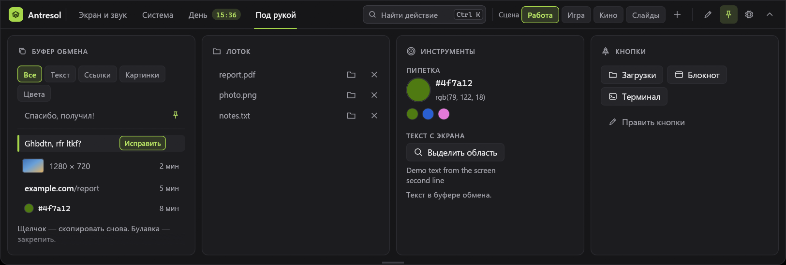

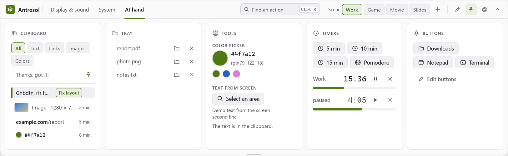

- **Что запоминается.** Копии собираются, даже пока панель спрятана: текст, а если текста нет — картинка (таблица из Excel
  или абзац из Word — это текст, снимок «Ножниц» — картинка). Вид записи — по ней самой: ссылка, цвет или просто текст
  (ниже). Копии, которые менеджеры паролей помечают «не запоминать» (форматы буфера `ExcludeClipboardContentFromMonitorProcessing`,
  `Clipboard Viewer Ignore` и `CanIncludeInClipboardHistory` = 0), пропускаются — и текст, и картинки; тексты длиннее
  4000 знаков — тоже (огромную копию, вроде лога, панель даже не читает); закреплённый текст в недавнее не попадает. То, что
  было в буфере до запуска панели, тоже попадает в историю. Цвет «Пипетки» попадает сюда сам: она кладёт код цвета в буфер,
  а история узнаёт в нём цвет. Буфер читает отдельный поток, а не окно панели: если программа отдаёт большую картинку не
  сразу (удалённый рабочий стол, Office), панель не подвисает, а запись появляется, когда картинка прочитана.
- **Строка недавнего.** Справа — сколько назад скопировано («сейчас», «2 мин», «1 ч»); под мышью вместо времени появляются
  кнопки (у картинки кнопок нет — время остаётся). Подсказка к строке — начало текста (до 300 знаков) или адрес ссылки: в
  строке видно не всё. Щелчок по строке — запись снова в буфере («В буфере — вставляйте») и наверху истории: текст, ссылка и цвет —
  текстом, картинка — картинкой.
  - *Текст* — одной строкой (переводы строк — пробелами).
  - *Ссылка* — одна строка без пробелов, начинается с `http://`, `https://` или `www.`: сайт полужирным, остальное тише
    («example.com/report»). Под мышью левее булавки — кнопка «Открыть в браузере» (`www.` открывается по https).
  - *Цвет* — кружок и код моноширинным: `#rrggbb`, `#rgb` (если в нём есть буква: «#123» — скорее номер, чем цвет) и
    `rgb(r, g, b)`. В буфер он возвращается таким, каким его скопировали (`rgb(79, 122, 18)` — `rgb(79, 122, 18)`, `#FFF` —
    `#FFF`); цвет «Пипетки» — `#rrggbb`. Один и тот же цвет — одна запись, как бы он ни был записан.
  - *Картинка* — миниатюра (середина кадра по пропорции 3 : 2, 36 × 24) и размер: «1280 × 720». Полное название —
    «Картинка · 1280 × 720» — в подсказке и для программ экранного чтения. Одна картинка — до 40 МБ и не больше 8192 точек по
    стороне: полный снимок экрана 4K (33 МБ) запоминается, **полный снимок двух мониторов 4K не запоминается**. Все картинки
    истории вместе — не больше пяти штук и 80 МБ, старые уходят первыми. Хранятся они только в памяти (на диск ничего не
    пишется). Картинку не закрепить: закреплённое лежит в `config.txt`, а картинок там нет.
- **Фильтр.** Чипы показывают записи одного вида; закреплённое видно при «Все» и «Текст». Таких записей нет — «Здесь пока
  ничего нет». На узкой карточке чипы переносятся на вторую строку. Фильтр помнится, пока работает программа; «Очистить»
  возвращает «Все».
- **Исправить раскладку.** Текст, набранный не в той раскладке, — русский в английской («Ghbdtn? rfr ltkf&») или
  английский в русской («Рщц фку нщг,») — узнаётся сам: у последнего скопированного справа кнопка (по-русски «Исправить»,
  по-английски «Fix layout»; полное название — «Исправить раскладку» — в подсказке и для программ экранного чтения), у
  остальных текстов — под мышью. Подсказка к ней говорит, что получится: «Похоже на русский текст, набранный в английской
  раскладке: «Привет, как дела?»» (или «Похоже на английский текст, набранный в русской раскладке: «…»»). Щелчок кладёт в
  буфер исправленный текст («В буфере — вставляйте») и поднимает его наверх истории; исходный остаётся ниже. Если и
  надписи не хватает места (строка уже примерно 200 точек), вместо неё — значок ↻ на той же кнопке, с той же подсказкой.
  - *Как переводится.* По клавишам ЙЦУКЕН ↔ QWERTY. Клавиши `[ ] ; ' , .` и `` ` `` — буквы х, ъ, ж, э, б, ю, ё: внутри слова они
    буквы («cgfcb,j» — «спасибо»); в начале слова — буква, если слово с ней похоже на русское («'nj» — «это»); в конце
    слова знак остаётся знаком («Ghbdtn,» — «Привет,»), кроме `[` и `` ` `` (х, ё) и точки перед словом с маленькой буквой
    или в конце текста — это «ю» («Gjplhfdkz.» — «Поздравляю»), если в тексте нет запятой после слова (она выдаёт обычную
    пунктуацию — тогда и точки остаются точками: «Ghbdtn, rfr ltkf.» — «Привет, как дела.»).
  - *Знаки, как их набирают.* Русская пунктуация лежит на других клавишах, чем английская, поэтому набранное не в той
    раскладке выглядит так: точка — `/`, запятая — `?` (Shift+/), вопрос — `&` (Shift+7), двоеточие — `^`, точка с запятой —
    `$`, кавычка — `@`, «№» — `#`. «Ghbdtn? rfr ltkf&» — «Привет, как дела?»; «Dhtvz^ 10 vbyen» — «Время: 10 минут»;
    «Crf;b @lf@» — «Скажи "да"»; «Dcnhtxf d 15^00» — «Встреча в 15:00». `?` после слова — запятая, если за ним идёт ещё
    слово; последний `?` текста остаётся вопросом (как и в образце «Ghbdtn, rfr ltkf?», где запятая — обычная запятая).
    Такие знаки в тексте — признак набора клавишами: запятая, точка с запятой и точка в конце слова тогда буквы б, ж, ю
    («масштаб», «вживую»). Без этих признаков слова на «б» и «ж» в конце («хлеб», «муж») получат знак вместо буквы. В
    обратную сторону так же: запятая русской раскладки — это `?` («Рщц фку нщг,» — «How are you?»), русская точка — `/`,
    «Ж» и «Э» — `:` и `"`. Цифры, пробелы, `!`, скобки и дефис остаются как набраны. `@`, `#`, `$`, `^`, `&` в других местах
    (адрес почты, хештег, `$HOME`, `x^2`, `AT&T`) — код, и такой текст не трогается.
  - *Что предлагается.* Только обычная речь: не меньше трёх букв (одно слово — не меньше четырёх: `pdf`, `png`, `css`),
    все буквы одной письменности, и перевод заметно больше похож на другой язык, чем исходный на свой (по доле частых пар
    соседних букв из небольших списков; с вопросом или двоеточием, набранными клавишами, как «Где ты?» — `Ult ns&`, —
    хватает, чтобы перевод был похож на русский). Адреса, пути, ссылки, код (`::`, `{`, `=>`), числа, цвета, `camelCase`,
    смесь русских и латинских букв и тексты длиннее 1000 знаков не трогаются; одно слово заглавными до пяти букв (`LGTM`,
    `HTTP`) — сокращение, кнопки нет; не узнаётся — кнопки нет. Бывает и промах: короткая фраза или слово из четырёх-пяти
    букв, похожие на нужный язык, получат кнопку зря (ничего не меняется, пока её не нажали).
- **Булавка.** У строки недавнего под мышью справа появляется булавка (у картинки её нет): щелчок закрепляет — запись
  уходит из недавнего наверх закреплённого как текст (цвет — как скопирован; до 30; полно — «Закреплено 30 — открепите
  лишнее»). Булавка у закреплённой (акцентом) — «Открепить»: текст возвращается наверх недавнего тем видом, каким он
  читается (ссылка — ссылкой, цвет — цветом; история выключена — возвращаться некуда: текст пропадает, и об этом говорит
  уведомление «Откреплено»). Закреплённое лежит в `config.txt` строками `snippet=` (перевод строки — `\n`, обратная косая —
  `\\`; пробелы в начале и в конце не сохраняются) и переживает перезапуск; недавнее хранится только в памяти — после
  выхода из программы его нет.
- **Конец списка** — «Щелчок — скопировать снова. Булавка — закрепить.» и «Очистить» (забывает всё недавнее, а не только
  показанное под фильтром; закреплённое остаётся).
- **История выключена** («Запоминать скопированное (только в памяти)» в настройках): недавнего нет, вместо него пояснение
  «Запоминание выключено в настройках.» и кнопка «Закрепить из буфера» — то, что сейчас в буфере (текст), встаёт первым в
  закреплённом; в буфере не текст — «В буфере нет текста». Закреплённое работает как обычно (открепить — текст пропадает,
  уведомление «Откреплено»). Выключили запоминание — всё недавнее стирается сразу, и картинки тоже (как в журнале буфера
  Windows: выключают его ради приватности и ждут, что собранное исчезнет); включили снова — история начинается заново, то,
  что копировали, пока было выключено, в неё не попадает.

## Инструменты

- **Пипетка** — нажмите на круг и, не отпуская, тяните мышь на любой цвет экрана (круг показывает цвет под
  мышью); отпустили — код цвета («#4f7a12») в буфере обмена, рядом код и `rgb(…)`; если «Буфер обмена» запоминает, цвет
  попадает и в его историю — строкой с кружком. Последние шесть цветов — кружками ниже, щелчок — снова в буфер. Пока
  тянете, панель не прячется. Из поиска пипетка берёт цвет под мышью сразу (см. «Поиск действий»).
- **Текст с экрана** — «Выделить область»: через полсекунды открываются «Ножницы» Windows (`ms-screenclip:`; панель
  прячется, как обычно, когда мышь уходит с неё);
  выделили — снимок попадает в буфер, панель распознаёт на нём текст (Windows.Media.Ocr, на языках вашего
  профиля Windows) и кладёт текст в буфер вместо картинки (в истории «Буфера обмена» снимок остаётся картинкой, а
  текст — строкой над ней). В карточке — начало текста и «Текст в буфере
  обмена.»; текста нет — «Текст на снимке не найден.»; в Windows нет языка распознавания — подсказка, где его
  добавить. Пока ждём снимка — «Отмена»; не выделили за минуту — ожидание снимается само. Большой снимок
  уменьшается до предела распознавания Windows.

## Лоток

Бросьте файлы или папки на открытую панель (на полоску у края бросать нельзя — сначала дайте панели
выехать) — они лягут в «Лоток», новые сверху, до 30. Щелчок — открыть, значок папки — «Показать в папке», крестик — «Убрать из лотка».
Файла больше нет — пометка «нет файла». Список хранится в настройках (`tray=`) и переживает перезапуск.
«В лоток» на плашке готовой загрузки (см. «Живые плашки у края») кладёт файл сюда же. Перетащить файл из лотка в другую
программу пока нельзя — тянуть можно только с плашки загрузки.

## Bluetooth

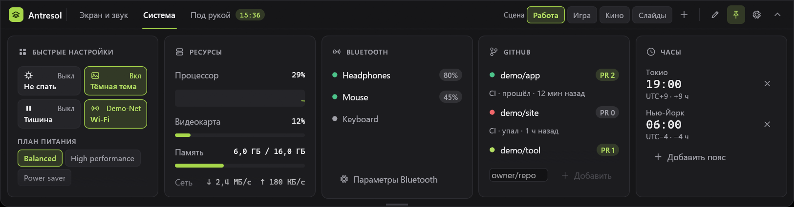

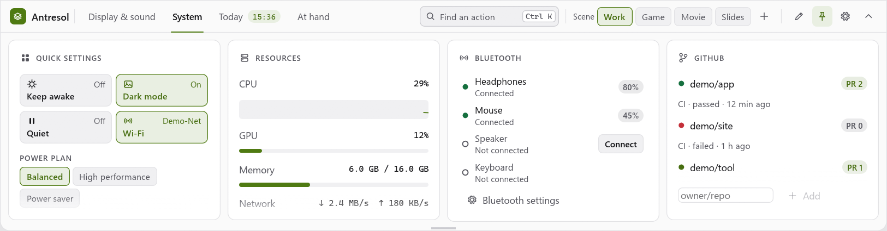

Сопряжённые устройства, подключённые сверху. Строка: слева зелёная точка — подключено, кольцо — нет, вертушка — идёт подключение или
отключение; имя и под ним состояние («Подключено», «Не подключено», «Подключение…», «Отключение…»); справа заряд, если Windows его знает
(20 % и меньше — жёлтым), или кнопка «Подключить». Нет сопряжённых — «Сопряжённых устройств нет.». Список перечитывается раз в 1,5 с,
пока панель открыта. «Параметры Bluetooth» — кнопка внизу, со значком «наружу» за словом — открывает параметры Windows.

**Подключить одним щелчком.** Наушники, гарнитуры и колонки (устройства класса «аудио и видео») подключаются и отключаются щелчком по
своей строке; то же — Tab до строки и Enter, а у не подключённого ещё и кнопка «Подключить». Подсказка у строки — «Щелчок — подключить» или
«Щелчок — отключить»; под мышью строка подсвечивается. Панель просит об этом драйвер устройства, как «Параметры Windows»; прав администратора,
по замыслу, не нужно (вживую не проверено). Фокус клавиатуры остаётся при той же строке, даже если устройство подключилось само и список
пересортировался (подключённые сверху); пока с устройством идёт работа, строка остаётся в Tab, но Enter и щелчок ничего не запускают.

- **Пока идёт**, строка — «Подключение…» (у отключения — «Отключение…») с вертушкой, без кнопки и заряда; второй щелчок ничего не запускает.
  Windows спрашивается раз в секунду, не дольше 15 секунд от щелчка (отключение — 10). Подключилось — «Подключено» и заряд. Если завис сам вызов
  драйвера, строка не остаётся в «Подключении…» навсегда: через 20 секунд от щелчка (отключение — 15) она снова прежняя и приходит то же уведомление.
- **Не вышло** — строка снова прежняя и уведомление. Просьба дошла до драйвера, а устройство не отозвалось за срок: «Не удалось подключить
  «Наушники»: включите устройство и поднесите ближе» (при отключении — «Не удалось отключить «Наушники»»). Просьба не ушла (у устройства нет звуковых
  точек Windows, драйвер отверг её) — сразу, не через 15 секунд, и другими словами: «Не удалось подключить «Наушники» из панели — подключите в
  «Параметрах Bluetooth»» (при отключении — «Не удалось отключить «Наушники» из панели — отключите в «Параметрах Bluetooth»»): совет «включите
  устройство» тут не про то. На части драйверов просьба может не сработать — тогда подключайте в «Параметрах Bluetooth», кнопка рядом.
- **Мышь, клавиатура, геймпад** — без кнопки и без щелчка: Windows подключает их сама, когда устройство включают (подсказка к строке:
  «Подключается само, когда устройство включают»).
- **Радио Bluetooth выключено** — над списком причина: «Bluetooth выключен — включите его в «Параметрах Bluetooth»» (список при этом может быть
  пуст из-за самого радио — «Сопряжённых устройств нет.» тогда не пишется); «Подключить» серая, подсказка «Bluetooth выключен», щелчок по строке ничего не
  делает, Tab её не берёт; панель Bluetooth не включает (только «Параметры Bluetooth» внизу).
- **Своё подключение** — из карточки или из поиска — плашки «подключено» не даёт: строка и так показывает. Устройство подключилось само
  (его включили) — плашка есть, как раньше.
- **В поиске** — «Подключить «Наушники»» и «Отключить «Наушники»» (см. «Поиск действий»).

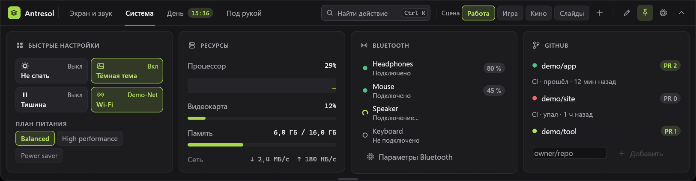

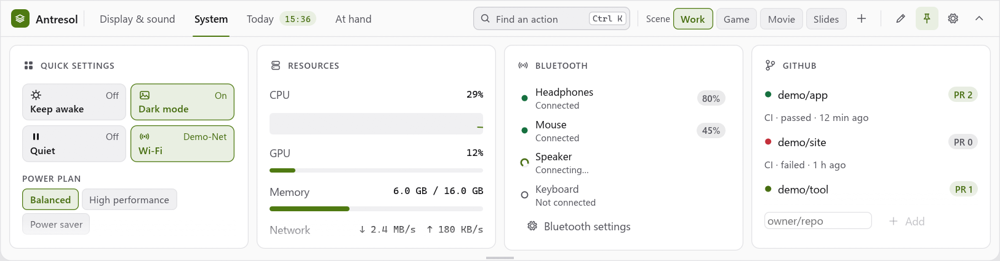

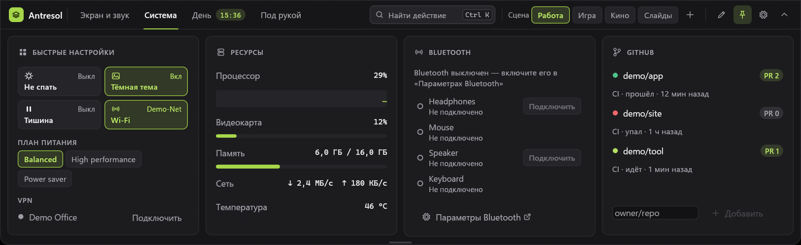

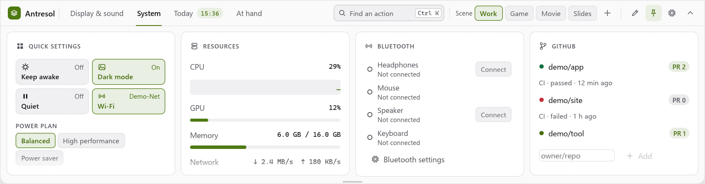

Подключились наушники (или другое аудиоустройство) сами либо заряд любого устройства упал до 15 % — плашка у края (см. «Живые плашки у
края»); для неё устройства читаются и при спрятанной панели, раз в 5 с, пока плашки Bluetooth включены.

## Встречи

Карточка на полке «День» — первая на ней и шире соседей (полторы доли ширины, наименьшая 260). Показывает ближайшую встречу из
календаря Google или Outlook и одной кнопкой подключает к ней. Учётная запись Windows не нужна: календарь читается по
**секретной ссылке на файл .ics**, которую даёт сам календарь.

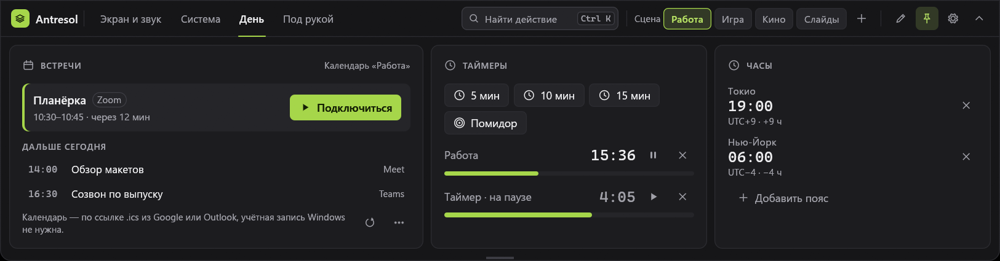

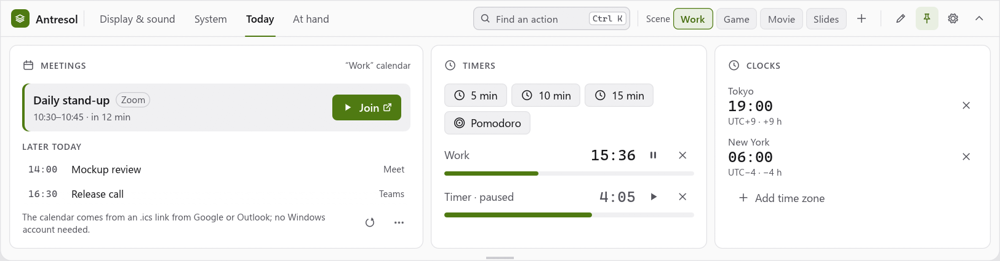

**Как подключить.** Пока календаря нет, в карточке — слова «Покажу ближайшие встречи и кнопку «Подключиться» из календаря Google
или Outlook по секретной ссылке .ics», поле «Ссылка на календарь» с кнопкой «Добавить» и, под ними, где взять ссылку:

- «Google: Настройки календаря → Секретный адрес в формате iCal»;
- «Outlook: Параметры → Календарь → Общие календари → Опубликовать календарь → ICS».

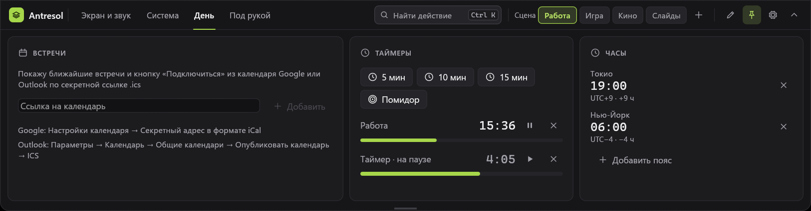

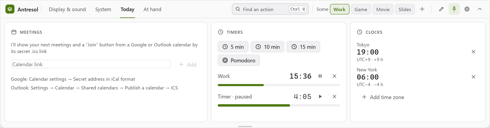

Вставьте ссылку в поле и нажмите «Добавить» (или Enter). Подходит `https://…` и `webcal://…` (так дают iCloud и часть Outlook;
читается как https); `http://`, ссылка с `user@`, с пробелами и длиннее 2000 знаков не годятся — под полем «Нужна ссылка вида
https://… или webcal://…», а «Добавить» не работает. Ссылка, что уже есть в списке, — «Этот календарь уже есть», «Добавить» тоже не работает.
Esc в поле стирает набранное и не прячет панель (следующий Esc прячет).

**Ссылка — секрет:** кто её знает, видит весь календарь. Поэтому набранное в поле — точки, под ним — только сайт и конец
(«calendar.example.com/…/basic.ics»: середина и запрос скрыты, а конец показывается, лишь если это общее имя файла `.ics` — короткое, из строчных букв, как `basic.ics` или `calendar.ics`), в окне
ссылка видна только так, а в журнал, ошибки, уведомления, плашки и снимки она не попадает. Хранится в `config.txt`
(`calendar=`, по строке на календарь, до пяти), больше нигде. Одно исключение — то, что вы сами скопировали: ссылка, взятая из браузера
через буфер обмена, попадает и в историю карточки «Буфер обмена» (только в память, до выхода из программы или «Очистить») — «Добавить»
убирает её оттуда сам. Но журнал буфера самой Windows (Win+V; при включённой синхронизации он идёт и на другие ваши устройства) может
сохранить ссылку: сотрите её там или выключите журнал буфера в параметрах Windows.

**Что в карточке.**

- Справа в заголовке — «Календарь «Работа»» (имя из файла, `X-WR-CALNAME`; нет — сайт ссылки) или «Календарей: 2»; в подсказке —
  сокращённые ссылки.
- **Ближайшая встреча** — идущая (до её конца) или следующая сегодня: на подложке с полоской акцента название полужирным, рядом
  служба в рамке («Zoom», «Meet», «Teams», «Телемост»…), ниже «10:30–10:45 · через 12 мин» или «10:30–10:45 · идёт · ещё 20 мин»
  (минуты округляются вверх; больше часа — «через 1 ч 20 мин»), справа главная кнопка «Подключиться». Нет ссылки на встречу — нет
  кнопки и службы. «Подключиться» — главная кнопка со значком «наружу» (она открывает браузер или программу службы). Тесно (рядом с кнопкой
  не помещается вторая строка) — кнопка одним значком (в подсказке «Подключиться · Zoom»), а рамка службы уступает название. Подсказка к плашке —
  полное название, время и место (если это не ссылка).
- **Идущая встреча при наложении.** Идущая встреча без ссылки (например «Фокус» с 9 до 17 или «Вне офиса» со временем) либо идущая
  дольше двух часов не держит главное место, если до её конца начнётся (или уже началась) встреча со ссылкой: главной становится та, а
  идущая уходит первой строкой в «Дальше сегодня» с подписью «до 17:00» вместо начала. Иначе длинный блок без ссылки занимал бы плашку весь
  день, а встреча в 10:30 с Zoom пряталась в списке. (Решение, которое можно поменять.)
- **«Дальше сегодня»** — до четырёх строк: время моноширинным (у идущей встречи — «до 17:00»), название, справа служба. Щелчок по строке
  со ссылкой тоже подключает; подсказка — полное название и время (и место, если это не ссылка: в ссылке бывает пароль, `pwd=`).
- Сегодня встреч больше нет — «Сегодня встреч больше нет» и первая завтрашняя строкой «Завтра 09:30 · Планёрка».
- Время — по часам этого ПК; «через N мин» пересчитывается раз в минуту. Одна и та же встреча в двух календарях — одна строка.
- Внизу — пояснение «Календарь — по ссылке .ics из Google или Outlook, учётная запись Windows не нужна.» (если помещается в две
  строки) и справа два значка: «Обновить» (прочитать календари сейчас) и «Календари» (подсказка называет и правый щелчок по карточке).

**Несколько календарей и список.** До пяти. Значок «Календари» внизу карточки или **правый щелчок по карточке** открывают в ней
список: у каждого календаря имя, сокращённая ссылка, слова ошибки, если последнее чтение не вышло, и крестик «Убрать календарь
«Работа»»; ниже «Добавить календарь» — то же поле, что и выше. «Готово» (или второй правый щелчок) возвращает встречи. Выпадающего
меню нет — окно равно панели.

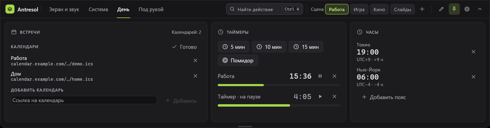

**Чтение.** Свой поток, окно не ждёт: раз в 10 минут, пока программа работает (и при спрятанной панели — плашка о встрече не ждёт,
пока панель откроют), сразу, когда календарь добавили, и по «Обновить»; идёт чтение — второе не начинается. Только https (перенаправления
— только на https), ответ не больше 32 МБ (рабочий календарь за годы бывает в десятки мегабайт), ждать не дольше 30 секунд. Больше 32 МБ
или больше 2000 событий — читается начало, под календарём «Календарь большой — прочитана только часть». Не вышло — слова под календарём, а прежние встречи остаются до следующей удачи: «Календарь не ответил»
(нет связи, ошибка сервера) или «Ссылка не на календарь» (ответили не календарём, ссылка отозвана — ответ 4xx); пока ничего не
прочитано — «Читаю календарь…». Встречи окна «вчера … +3 дня» считает тот же поток сразу после разбора, а когда меняются сутки, — другой
поток из уже прочитанного файла; окно только складывает готовое, поэтому тяжёлый или враждебный календарь панель не подвешивает. Сбой при
чтении или разборе — «Ссылка не на календарь», а не пустая карточка без слов. В журнал — только номер календаря и код («calendar 1: http 404»),
без адреса.

**Что понимает разбор** (`src/ics.rs`). События со временем: начало и конец (`DTEND` или `DURATION`), название, место, ссылка.
Время `…Z` — UTC; `TZID` — по `VTIMEZONE` из самого файла (смещения и правила перехода на летнее время: `STANDARD` и `DAYLIGHT` с
`RRULE` или `RDATE`; повторяющийся час осенью — первый, пропавший весной — по смещению до перехода); пояс, которого в файле нет, —
по часам этого ПК (имя — в журнал, раз за запуск); время без пояса — тоже по часам ПК. Повторы: `DAILY`, `WEEKLY`, `MONTHLY`, `YEARLY` с
`INTERVAL`, `BYDAY` (с номером: `2TU`, `-1FR`), `BYMONTHDAY`, `BYMONTH`, `BYSETPOS`, `WKST`, `COUNT`, `UNTIL`; серия держит стенное время
своего пояса (10:00 в Нью-Йорке остаётся 10:00 и после перевода часов, а по UTC сдвигается); `EXDATE`, замена одного повтора (`RECURRENCE-ID`:
перенесённый повтор показывается в своё новое время, а прежнее место пусто) и отмена (`STATUS:CANCELLED`) учитываются. Повторы
считаются на окно «вчера … +3 дня». Приглашение, которое вы отклонили (у основного календаря Google `X-WR-CALNAME` — ваша почта, и у вас
в `ATTENDEE` стоит `PARTSTAT=DECLINED`), не показывается; отклонён один повтор серии — пропадает только он. Не показываются события на весь день; `RDATE` у самих событий и `RANGE` у `RECURRENCE-ID` не
читаются. Календарь по ссылке — чужие данные, и всё, что в нём можно растянуть, ограничено: до 2000 событий (кончившееся больше двух суток назад в
счёт не идёт: старые годы большого календаря не съедают предел); значение свойства до 8 КБ (длиннее пропускается, а в описании ссылка
ищется в первых 64 КБ); `BYDAY` до 64 разных, `BYMONTHDAY` до 62, `BYSETPOS` до 32 (длиннее — повторов нет, встреча показывается один
раз); в поясе до 64 наблюдений и до 256 `RDATE`, поясов в файле до 64 (сверх — время по часам этого ПК); `EXDATE` до 1000 у события;
событие длиннее 31 дня (отпуск) — не встреча. Правила в `VTIMEZONE` читаются только годовые, без `COUNT` и с короткими списками (так
пишут настоящие пояса). Каждая серия считается со своим запасом шагов, чужие серии его не расходуют; серия со счётом (`COUNT`), что не
доходит до сегодняшнего дня за этот запас, считается кончившейся, а счёт, который до сегодняшнего дня заведомо не кончится, окну не
мешает. Замер худшего случая: файл в 32 МБ из 2000 враждебных серий разбирается за 0,2 с и считается за ~1 с в потоке чтения (release;
подробности — `docs/architecture/overview.md`), окно его не ждёт; обычный календарь на 2000 событий — доли процента от этого.

**Ссылка на встречу.** Берётся первая из `URL`, `LOCATION`, свойств служб (`X-GOOGLE-CONFERENCE`,
`X-MICROSOFT-SKYPETEAMSMEETINGURL`, `X-MICROSOFT-ONLINEMEETINGEXTERNALLINK`, `X-MICROSOFT-ONLINEMEETINGCONFLINK`) и `DESCRIPTION`
с сайтом службы: Zoom (`zoom.us`), Meet (`meet.google.com`), Teams (`teams.microsoft.com`, `teams.live.com`), Телемост
(`telemost.yandex.ru`), Jazz (`jazz.sber.ru`), Jitsi (`meet.jit.si`), Webex (`webex.com`), Whereby (`whereby.com`), Discord
(`discord.gg`, `discord.com`). Ссылка — чужие данные: только `https://`, хост — сайт службы или его поддомен (`us02web.zoom.us`, но не
`zoom.us.evil.example`), без `user@`, порта, пробелов, управляющих знаков и знаков не из ASCII, до 2000 знаков; иначе кнопки нет и встреча
показывается без неё. Открывается тем же `sys::launch`, что и другие адреса (за заслоном демо и тестов), проверяется ещё раз
перед открытием — у кнопки в карточке, у строки списка, у плашки и у поиска; не открылась — «Не получилось: Zoom» (так называют
и карточка, и плашка). В журнал ссылка встречи не пишется.

**Плашка перед встречей.** За 2 минуты до начала встречи со ссылкой у края появляется плашка (см. «Живые плашки у края»): «Планёрка
через 2 мин», «10:30 · Zoom» и главная кнопка «Подключиться» со значком «наружу»; значок плашки — календарь. Минуты считаются при
показе («через 1 мин», пока плашка висит). Она висит, пока её не закроют (крестик) или не начнётся встреча — тогда уходит сама, даже
ждущая очереди; на каждый повтор одна, закрытую больше не показывают. Висящая важная плашка без срока («сборка упала») её не
задерживает: встреча проходит вперёд, а та возвращается после. Как все плашки, кроме таймера, ждёт, пока Windows принимает
уведомления (показ экрана, игра, «не беспокоить»): название встречи не всплывает поверх показа; «тихое время» нового пользователя Windows и
приложение из магазина на экране плашке не помеха. Панель выдвинута — то же уведомлением («Планёрка через
2 мин · 10:30 · Zoom»). Выключатель — «Настройки» → «Панель» → «Живые плашки» → «Встречи» (`meetings` в `plaques_off=`).

**Поиск.** «Подключиться к встрече «Планёрка»» — до трёх ближайших встреч со ссылкой (идущих или впереди, сегодня и завтра); то же, что
кнопка в карточке. Находятся по названию встречи и по словам «встреча», «созвон», «подключиться», «meeting», «join» и названию службы.
Нужна карточка «Встречи» на какой-нибудь полке.

## Таймеры

«5 мин», «10 мин», «15 мин» — простой таймер; «Помидор» — 25 минут «Работы» и 5 «Отдыха» по кругу. У
каждого — оставшееся время, полоса прошедшего, значок паузы и продолжения (подсказки «Пауза» / «Дальше»), крестик — «Убрать
таймер». На паузе время серым (`weak`, а не бледным), а к названию добавлено «на паузе» (в узкой карточке — только
«на паузе»). Пусто — «Таймеров нет — запустите кнопкой выше.». Идущий таймер (ближайший, если их несколько) виден
меткой с оставшимся временем на вкладке этой полки, пока открыта другая (см. «Шапка и полки»). Таймеры идут,
пока панель спрятана; дошёл — плашка у края («Таймер дошёл», «Работа закончилась — отдых 5 минут», «Отдых
закончился — снова работа») с «Готово», она висит, пока не нажмёте; панель не выезжает и клавиатуру не берёт, даже при
выключенной полоске (см. «Живые плашки у края»; панель выдвинута — то же уведомлением). Звука нет. Хранятся только в памяти — после выхода их нет. Таймер со своим именем заводят из поиска
(«чай 5»): в списке он называется по имени, дошёл — «Таймер «чай» дошёл» (см. «Поиск действий»).

## Часы

Время в других поясах: своё название, время крупно, ниже смещение от UTC и разница с этим ПК («UTC+9 · +6 ч»).
Летнее время учитывается, как в часах Windows. «Добавить пояс» — поиск по поясам Windows (английские ключи:
«Tokyo», «Eastern»…), щелчок по строке — добавить с названием из ключа; Esc или «Отмена» — отменить поиск (панель
остаётся); крестик — «Убрать часы». До 8 часов;
хранятся в `config.txt` строками `clock=Название | Ключ пояса` (название можно поправить в файле). «Добавить пояс» есть и в
поиске действий.

## GitHub

Свои репозитории: поле «owner/repo» и «Добавить» (имя — `владелец/имя`), крестик — «Убрать репозиторий».
У каждого — точка по последнему прогону CI (зелёная — прошёл, красная — упал, акцент — идёт или в очереди,
серая — отменён или прогонов нет, жёлтая — не прочитать), строка «CI · прошёл · 12 мин назад» и «PR N» —
открытые пулл-реквесты (считаются до 100). Щелчок по имени — страница Actions в браузере (не открылась — «Не получилось: имя»). Читается раз в 5 минут,
пока панель открыта, и сразу — когда список поменялся; CI отсюда не запускается. Последний прогон сменил состояние — плашка
у края: «сборка упала» (висит, пока не закроют) или «сборка прошла» (см. «Живые плашки у края»); для неё прогоны читаются и при
спрятанной панели, раз в 5 минут, пока плашки GitHub включены, — один запрос на репозиторий, без пулл-реквестов. Пулл-реквесты
читаются отдельно, тоже не чаще раза в 5 минут и только для карточки. На репозиторий — не больше 24 запросов в час (12 на
прогоны и 12 на пулл-реквесты); без токена GitHub отвечает только про открытые репозитории и не больше 60 раз в час на всех —
без токена держите не больше двух репозиториев. Для закрытых впишите в `config.txt` строку `github_token=` со своим токеном
(только чтение; хранится открытым текстом в папке пользователя). Ошибки: «Не найден (или закрытый — нужен токен)», «GitHub
ограничил запросы — позже».

## Свои кнопки

Файл `%APPDATA%\Antresol\buttons.txt`, при первом запуске кладётся образец. Строка — кнопка:

```
название | что открыть | аргументы | значок
Загрузки | %USERPROFILE%\Downloads
Терминал | powershell.exe | -NoExit | terminal
Сайт     | https://example.com
```

Строки с `#` и пустые пропускаются, строка без названия или без «что открыть» — тоже. Аргументы и
значок — по желанию, неизвестный значок — как без него. Подсказка у кнопки — что она откроет. `%ПЕРЕМЕННЫЕ%` раскрываются. Значки: folder file terminal code
window rocket gear hammer image film cube gamepad server search clock target layers package
broadcast; без значка он выбирается сам (папка, программа, адрес, файл). «Править кнопки» открывает
файл в Блокноте; сохранили — кнопки обновятся сами при следующем показе панели (пока она открыта —
в течение 1,5 с).

## Обновления

С 2.9 панель обновляется сама (общий `anvil-update` набора Anvil, как у Kamerton). Через минуту после запуска (при входе
в Windows сети может ещё не быть) и раз в сутки, если в настройках включено «Проверять обновления», она спрашивает GitHub,
нет ли выпуска новее; не удалось спросить — ещё раз через 15 минут. Есть — над карточками баннер
«Вышла vX.Y.Z»: **«Обновить»** скачивает архив, сверяет его с `SHA256SUMS` выпуска (не сошлось — не ставит) и кладёт новую
версию на место старой; «Позже» прячет баннер до следующей проверки, «Пропустить» больше эту версию не предлагает, «Что
нового» — заметки к выпуску. Пока качается — доля; скачалось — «Обновление установлено» и **«Перезапустить»**: панель
закрывается, новая версия ждёт, пока старая выйдет (до 20 с, — иначе сочетания клавиш были бы у неё «заняты»), и
запускается с теми же настройками. Не вышло — «Обновление не удалось» и «Повторить»; рабочей остаётся старая версия.
Баннер стоит над карточками: на полке «по полке» панель вырастает на его высоту, на полке со своей высотой — тоже. Esc при
открытом «Что нового» закрывает только его. Обновлению нужна запись в папку программы: на время загрузки рядом с exe
появляется `.anvil-update`, старый exe остаётся рядом как `antresol.exe.old-…` и убирается при следующем запуске (в
`Program Files` без прав администратора обновление не встанет). Сумма из `SHA256SUMS` защищает от битой загрузки; exe пока
без подписи.

В настройках, в карточке «Оформление», — раздел «Обновления»: «Проверять обновления», «Предлагать пред-выпуски»,
состояние и одна кнопка по нему: «Проверить», «Обновить», «Перезапустить» или «Повторить». В демо-режиме обновления не
проверяются. В `config.txt` — `updates=0` (не проверять), `prerelease=1`, `skip_version=` (пропущенная версия).

## Настройки

Шестерёнка в шапке (назад — «‹ Настройки» слева). Три карточки (какие карточки на панели, на каких полках и в каком
порядке — не здесь, а правка полок: карандаш в шапке); уже 930 точек — листаются вбок:

- **Панель** — «Запускать вместе с Windows», «Не выезжать поверх игр и видео во весь экран», «Полоска у края,
  пока панель спрятана», «Медиа на спрятанной полоске» (только при включённой полоске), «Запоминать
  скопированный текст», «Живые плашки» — чипы «Bluetooth», «Флешки», «GitHub», «Загрузки», «Встречи» (по умолчанию включены
  все; таймер — всегда; см. «Живые плашки у края»), «Не выезжать над программами» — список имён файлов (крестик — убрать), «Добавить «…»» —
  последняя программа, которая была на переднем плане; «Выезжать через» — чипы 0, 150, 300, 600 мс;
  «Прятаться через» 100–3000 мс (шаг 50); внизу — «Закрыть Antresol». Монитор панели — в шапке («Все» —
  панель у того монитора, к краю которого подошла мышь; горячая клавиша показывает её там, где она была
  в последний раз).
- **Сцены** — у каждой сцены: имя полужирным, справа «Изменить…» (открывает правку сцены; назад из неё — в настройки) и
  корзина (спрашивает «Удалить сцену «…»?» тут же, на месте строки); ниже клавиша: «Изменить…», затем нажать сочетание с Ctrl или Alt и буквой, цифрой,
  F1–F24 или пробелом (Shift — по желанию; Esc — отмена), «Работает» или «Занято другой программой», крестик — убрать
  клавишу. Сцен нет — «Сцен пока нет — «+» в шапке создаёт сцену из текущих настроек.». Клавиша сцены работает и при
  спрятанной панели (см. «Сцены»). Сочетание показа панели сцене взять нельзя; то же сочетание у другой сцены переходит
  к этой.
- **Оформление** — строками: «Тема» (тёмная, светлая, как в системе), «Язык», «Цвет» — пять образцов (лайм —
  по умолчанию, фиолетовый, индиго, фуксия, лазурь) и «+» — «Свой цвет…» (свой выбран — «+» залит им); ниже —
  клавиша показа панели: «Изменить…» и сочетание (то же правило, что у сцен; сочетание сцены — «Это
  сочетание у сцены «…» — выберите другое»), «Работает» или «Занято другой программой» (своё занято —
  запасного нет, панель только от края; выберите другое или «Как по умолчанию»), «Как по умолчанию» — снова
  первое свободное; ниже — «Обновления» (см. «Обновления»). Версия — в шапке настроек справа. Пока ждём сочетание, текущая клавиша панели и клавиши
  сцен не работают.

### Свой цвет

Экран вместо настроек (назад — «‹ Настройки»). Слева — поле насыщенности и яркости и полоса оттенка (тянуть
или щёлкать), посередине — образец, «Код цвета» (`#a6d64a`), готовые цвета и «Взять цвет Windows» (цвет
акцента Windows; не прочитался — «Цвет Windows не прочитать»). Справа — пример в тёмной и светлой теме: чип,
главная кнопка, переключатель, ссылка и контраст — «Текст» (худший из фонов панели, карточки, кнопки и
подложки акцента) и «На кнопке», галочка — не ниже 4,5:1. Цвет сам подстраивается под каждую тему: в тёмной
осветляется, в светлой затемняется, пока текст не станет читаемым («Подправлен для читаемости» или «Как
выбран»). Панель перекрашивается сразу; «Применить» — сохранить (готовый цвет — его именем, свой — кодом), «Отмена», «‹ Настройки», Esc или уход
панели — вернуть прежний цвет.

Автозапуск хранится в реестре (`HKCU\Software\Microsoft\Windows\CurrentVersion\Run`), остальное — в
`%APPDATA%\Antresol\config.txt`, строки `ключ=значение`: `lang`, `theme`, `width`, `height`, `monitor`, `updates`,
`prerelease`, `skip_version` (обновления),
`show_delay_ms`, `hide_delay_ms`, `fullscreen_guard`, `strip`, `media_strip`, `accent` (`lime`, `violet`,
`indigo`, `fuchsia`, `sky` или свой `#rrggbb`; незнакомое — лайм), `kamerton` (путь к `kamerton.exe`), `snippet` (закреплённые тексты буфера), `clock` (часы), `exclude` (через запятую), `clipboard`, `tray`
(строка на файл), `shelf` (полка — по строке на полку, по порядку: `shelf=@av|display,brightness,sound,media`,
`shelf=Работа|clipboard,tray`; своя высота полок — `shelf_heights=` по их порядку через запятую, пусто — по полке:
`shelf_heights=,470,,`; строки нет — все по полке (версия до 2.8 эту строку не знает и при своей записи её теряет); `height` — высота настроек, поиска и правок; имя — `@av`, `@sys`, `@day`, `@hand` для готовых «Экран и звук», «Система», «День», «Под рукой»
(следуют за языком) или своё, символ `|` в нём заменяется пробелом; после `|` — ключи карточек через запятую, пусто —
пустая полка; незнакомые ключи и повторы пропускаются, не названная нигде знакомая карточка встаёт в конец своей
готовой полки; нет такой — «День» заводится в конце (если полок меньше девяти), а у остальных готовых полок (они были уже в 1.9) —
в конец последней), `hidden` (убранные карточки; такая карточка на полках не стоит),
`github` (репозитории), `calendar` (ссылка на календарь .ics для «Встреч», `https://…` или `webcal://…`; по строке на календарь,
до пяти; **секрет** — в файле открытым текстом, не показывайте его и не публикуйте), `plaques_off` (какие плашки выключены:
`bluetooth,usb,github,downloads,meetings`),
`github_token` (свой токен, по желанию), `panel_hotkey`
(«Ctrl+Alt+Q»; нет строки — первое свободное), `monitor=*` — все мониторы; там же сцены — строки `profile=` (так
называлось, пока сцены были профилями экрана), по строке на сцену:

```
profile=Кино | Ctrl+Alt+3 | \\.\DISPLAY1 3840x2160@60 150% hdr | night=0; quiet=1; awake=1; bright=80; plan={381B4222-F694-41F0-9685-FF5BB260DF2E} | undo=0
```

— части через `|`: имя; клавиша или пусто; **экран** — мониторы через `;`: устройство, `ШxВ@Гц`, после них по желанию
масштаб (`100%`) и `hdr` (включить HDR) или `sdr` (выключить), в любом порядке; нет слова — HDR не трогать; незнакомое
слово или повтор — строка пропускается; пустая часть — экран сцена не меняет; **система** — `ключ=значение` через `;`:
`night`, `quiet`, `awake`, `dark`, `wifi` (`1` — включить, `0` — выключить), `bright` (0–100) и `plan` (GUID плана
питания); нет ключа — настройку не трогать; незнакомый ключ и кривое значение пропускаются, а сцена остаётся; **`undo=0`**
— повторный щелчок не возвращает (нет части — возвращает). Четвёртой и пятой части может не быть: строка из трёх частей —
такая, как писали до 2.1, — читается как сцена, что меняет только экран; её при записи не меняют. Сцена, в которой нечего
ставить (ни экрана, ни системы), не читается и не записывается. Избранное и частоты — строки
`favorite=\\.\DISPLAY1 2560x1440` и `rate=\\.\DISPLAY1 2560x1440 144`.

Файл от версий до 1.9 (строка `modules=` — порядок карточек в одной ленте — и нет строк `shelf=`) читается как есть:
панель берёт полки по умолчанию, убранные (`hidden=`) остаются убранными, а порядок карточек внутри каждой полки —
по старому `modules=` (кто был раньше в ленте, тот раньше на полке); «Заготовки» из старых `modules=` и `hidden=`
пропускаются, а сами заготовки (`snippet=`) теперь закреплены в «Буфере обмена». При первом сохранении `modules=`
из файла пропадает (его больше не пишут): вернуться на 1.7 можно, но порядок карточек она возьмёт по умолчанию.

**Откат на версию до 2.0.** Версии до 2.0 не знают слов `hdr` и `sdr` в `profile=`. Профиль с масштабом (`… 100% hdr`) они
прочтут, не заметив слова, а при первом сохранении потеряют его; профиль без масштаба (`… hdr`) пропустят целиком — после
отката его надо завести заново. Других различий между файлами 1.9 и 2.0 нет.

**Откат на версию до 2.1.** Версии до 2.1 читают в `profile=` только первые три части. Сцену с системной частью они
прочтут как профиль, что меняет только экран, а при первом сохранении потеряют системную часть и `undo=0`. Сцену без
экрана (третья часть пуста) они не прочтут вовсе: после отката она пропадёт из файла при первом сохранении. Возврат
вторым щелчком и правку сцены версии до 2.1 не знают — у них профиль только ставится, а сохраняется «+» из текущего экрана.
